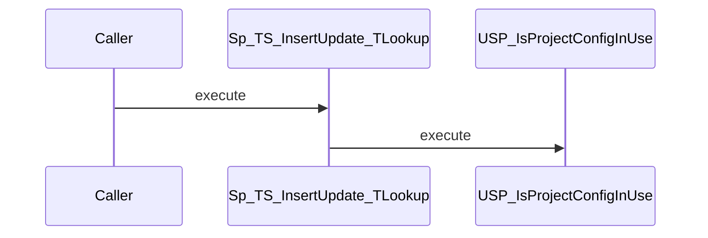
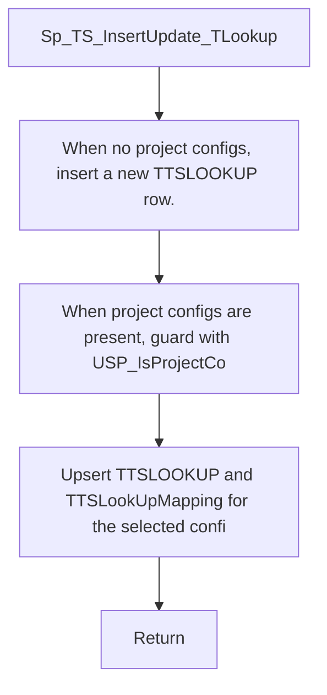

# Sp_TS_InsertUpdate_TLookup

## What it does

Inserts or updates TimePort reference lookup values and project mappings. When project configs are supplied, calls USP_IsProjectConfigInUse before mapping changes.

## Parameters

| Name | Direction | What it is for |
|---|---|---|
| `@LookupID` | in | Existing lookup id or 0 for insert |
| `@LookupName` | in | Lookup name |
| `@LookupDesc` | in | Lookup description |
| `@LookupParentId` | in | Parent lookup id |
| `@SubParentId` | in | Sub-parent id |
| `@pEmployerid` | in | Employer id |
| `@Isdeleted` | in | Deleted flag |
| `@IsTimeOff` | in | Time-off flag |
| `@IsHoliday` | in | Holiday flag |
| `@ProjectConfigIds` | in | Comma-separated project config ids |
| `@IsBillable` | in | Billable flag |
| `@LoginUserID` | in | Acting employee id |
| `@EffectiveUntil` | in | Effective date |

## Call sequence

## Callers

Application only. timeportDAL.InsertUpdateLookup.

## Nested

| Object | Kind | Page |
|---|---|---|
| `USP_IsProjectConfigInUse` | procedure | [USP_IsProjectConfigInUse](/docs/database/hrm-timeport/USP_IsProjectConfigInUse) |

## Steps

In `HRMS-DATABASE/HRM-TIMEPORT/STOREPROCEDURE/Sp_TS_InsertUpdate_TLookup.sql`:

1. When no project configs, insert a new TTSLOOKUP row.
2. When project configs are present, guard with USP_IsProjectConfigInUse flag ManageReferenceData.
3. Upsert TTSLOOKUP and TTSLookUpMapping for the selected configs.

## Tables

| Table | Read or write |
|---|---|
| `TTSLOOKUP` | write |
| `TTSLookUpMapping` | write |

## Unresolved calls

None recorded for this page.

## Flow

