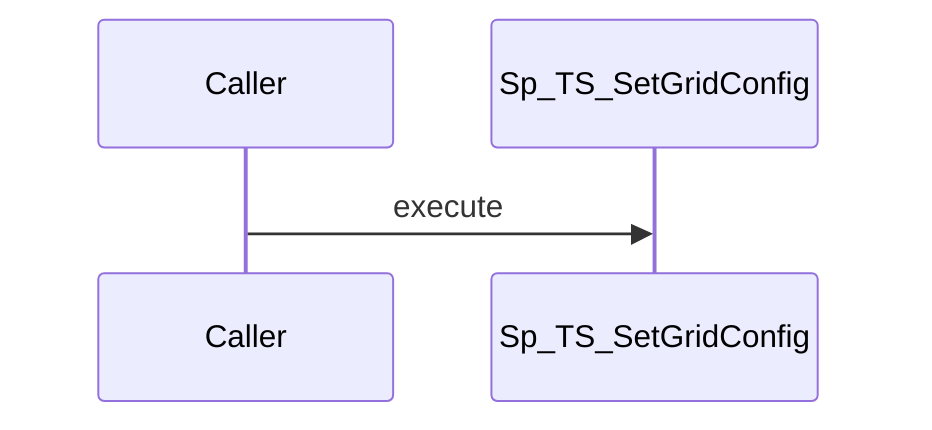
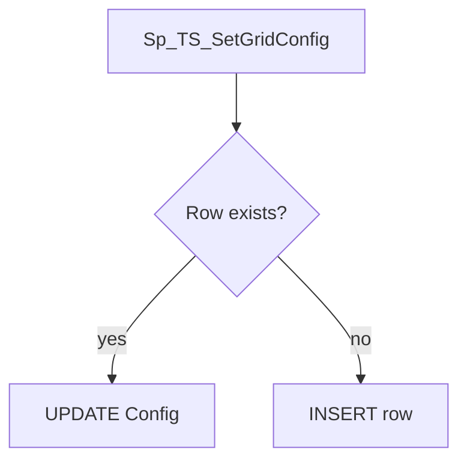

# Sp_TS_SetGridConfig

## What it does

Upserts one grid config type for an employee/grid into `TDATA_GRID_CONFIG` (update when the ConfigType row exists, otherwise insert).

## Parameters

| Name | Direction | What it is for |
|---|---|---|
| `@pEmployeeId` | in | Employee |
| `@pGridId` | in | Grid key |
| `@pConfigType` | in | Config type key |
| `@pConfig` | in | JSON/text payload |

## Call sequence

## Callers

No other procedure or function under STOREPROCEDURE or FUNCTIONS executes this object. Application caller: TimePort DAL `setGridConfig`.

## Nested

Calls no other procedures or functions.

## Steps

In `HRMS-DATABASE/HRM-TIMEPORT/STOREPROCEDURE/Sp_TS_SetGridConfig.sql`:

1. If a row exists for employee/grid/config type, UPDATE Config.
2. Else INSERT a new `TDATA_GRID_CONFIG` row.

## Tables

| Table | Read or write |
|---|---|
| `TDATA_GRID_CONFIG` | read/write |

## Flow

