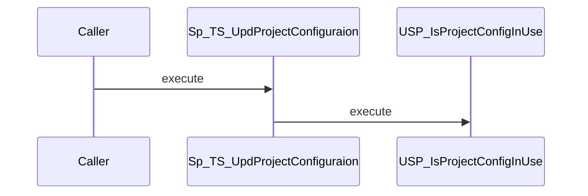
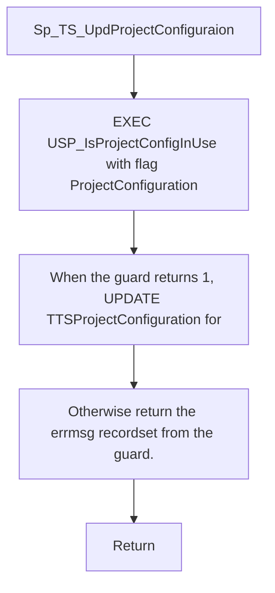

# Sp_TS_UpdProjectConfiguraion

## What it does

Updates an existing TTSProjectConfiguration row after checking EffectiveUntil conflicts through USP_IsProjectConfigInUse.

## Parameters

| Name | Direction | What it is for |
|---|---|---|
| `@ProjectConfigId` | in | Project configuration id to update |
| `@ProjectId` | in | Project id |
| `@Projectname` | in | Project name (DAL input) |
| `@ProjectDesc` | in | Description |
| `@BusinessId` | in | Line of business id |
| `@CostCenter` | in | Cost center id |
| `@Frequency` | in | Review frequency |
| `@ShowAttendanceData` | in | Show attendance flag |
| `@TaskStartEndTimeReq` | in | Task start/end required |
| `@StartDate` | in | Start date |
| `@EndDate` | in | End date |
| `@ReminderFrequency` | in | Reminder frequency |
| `@SDLCReq` | in | SDLC required |
| `@WorkProductTypeReq` | in | Work product type required |
| `@IsActive` | in | Active flag |
| `@EmployerId` | in | Employer id |
| `@ModifiedBy` | in | Modifying employee id |
| `@ClientId` | in | Client id |
| `@IsDescriptionMandatory` | in | Description mandatory |
| `@TimesSheetIsSync` | in | Sync flag |
| `@EffectiveDate` | in | New EffectiveUntil |
| `@InvoicingFreq` | in | Invoicing frequency |
| `@IsHolidaysIncludedForTSExport` | in | Holiday export flag |
| `@IsLeavesIncludedForTSExport` | in | Leave export flag |

## Call sequence

## Callers

Application only. timeportDAL.UpdProjectConfiguraion from TimePort Setup Master Projects tab.

## Nested

| Object | Kind | Page |
|---|---|---|
| `USP_IsProjectConfigInUse` | procedure | [USP_IsProjectConfigInUse](/docs/database/hrm-timeport/USP_IsProjectConfigInUse) |

## Steps

In `HRMS-DATABASE/HRM-TIMEPORT/STOREPROCEDURE/Sp_TS_UpdProjectConfiguraion.sql`:

1. EXEC USP_IsProjectConfigInUse with flag ProjectConfiguration.
2. When the guard returns 1, UPDATE TTSProjectConfiguration for ProjectConfigId.
3. Otherwise return the errmsg recordset from the guard.

## Tables

| Table | Read or write |
|---|---|
| `TTSProjectConfiguration` | write |
| `TTSEmpTimeSheet` | read (via nested) |

## Unresolved calls

None recorded for this page.

## Flow

