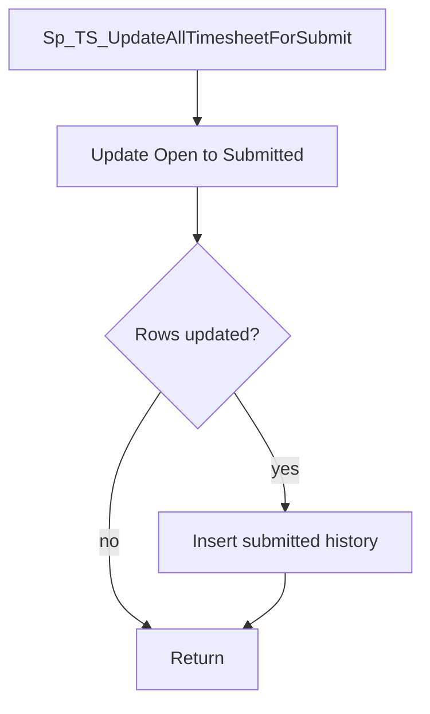

# Sp_TS_UpdateAllTimesheetForSubmit

## What it does

Bulk-submits Open timesheet rows for one employee/project/date range: sets `TSStatus` to the Submitted status id, stamps `ModifiedBy` / `SubmittedOn`, and inserts matching rows into `TSEmpTimesheetSubmitted_History`. Used by TimeSheet Status when the user selects Open summary rows and submits.

## Parameters

| Name | Direction | What it is for |
|---|---|---|
| `@EmployeeId` | in | Employee whose Open rows are submitted |
| `@ProjectId` | in | Project scope |
| `@PFromDate` | in | Inclusive start date |
| `@PTodate` | in | Inclusive end date |
| `@LoginUserID` | in | Actor recorded as modifier / history CreatedBy |

## Call sequence

Calls no other procedures or functions (status id resolved by subquery on `TSEmpTimesheetStatus`).

## Callers

Application: TimePort `UpdateAllTimesheetForSubmit` (TimeSheet Status bulk submit). No other procedure inventoried as a caller in this pass.

## Nested

Calls no other procedures or functions.

## Steps

1. Resolve Submitted and Open status ids from `TSEmpTimesheetStatus`.
2. `UPDATE TTSEmpTimeSheet` Open rows in the project/date window to Submitted; capture OUTPUT into a table variable.
3. If any rows updated, insert history rows into `TSEmpTimesheetSubmitted_History`.

## Tables

| Table | Read or write |
|---|---|
| `TSEmpTimesheetStatus` | read |
| `TTSEmpTimeSheet` | write |
| `TSEmpTimesheetSubmitted_History` | write |

## Unresolved calls

None.

## Flow

