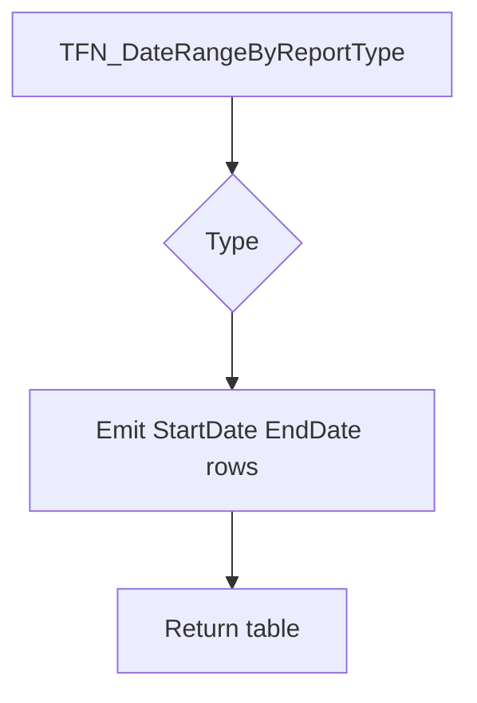

# TFN_DateRangeByReportType

## What it does

Table-valued function that returns StartDate/EndDate buckets for a report type (`W` weekly, `M` monthly, `P`/`D` daily, `B` bi-weekly, `F` fortnightly/bi-monthly) between `@FromDate` and `@ToDate`, with special weekly branches when invoicing frequency and `@requestfrom` are set.

## Parameters

| Name | Direction | What it is for |
|---|---|---|
| `@Type` | in | Report frequency char |
| `@FromDate` / `@ToDate` | in | Inclusive range |
| `@InvocingFeq` | in | Optional invoicing frequency for weekly variants |
| `@requestfrom` | in | Optional caller flag (e.g. `A`) |

## Call sequence

Calls no other procedures or functions.

## Callers

| Object | Kind | Page |
|---|---|---|
| `Sp_TS_ExportEmpTimeSheetReportByWeeklyMonthly` | procedure | [Sp_TS_ExportEmpTimeSheetReportByWeeklyMonthly](/docs/database/hrm-timeport/Sp_TS_ExportEmpTimeSheetReportByWeeklyMonthly) |
| `Sp_TS_ExportEmpTimeSheetReportByDaily` | procedure | [Sp_TS_ExportEmpTimeSheetReportByDaily](/docs/database/hrm-timeport/Sp_TS_ExportEmpTimeSheetReportByDaily) |
| `USP_Employee_ActualWorkedLeaveHours` | procedure | [USP_Employee_ActualWorkedLeaveHours](/docs/database/hrm-timeport/USP_Employee_ActualWorkedLeaveHours) |

## Nested

Calls no other procedures or functions.

## Steps

1. Branch on `@Type` (and sometimes `@InvocingFeq` / `@requestfrom`).
2. Use recursive CTEs or date arithmetic to emit contiguous StartDate/EndDate rows clipped to `@ToDate`.
3. Return `@DateRange` table.

## Tables

| Table | Read or write |
|---|---|
| — | none (pure date generation) |

## Flow

