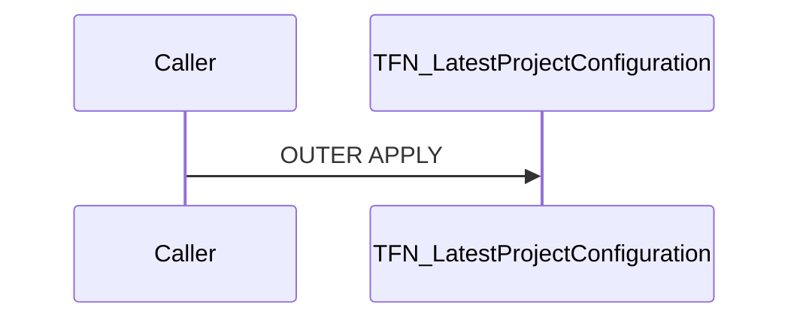
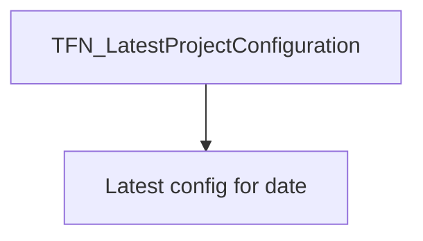

# TFN_LatestProjectConfiguration

## What it does

Returns the latest effective `TTSProjectConfiguration` attributes for an employer/config as of a timesheet date, supplying client/review/invoice/sync flags during approver modify.

## Parameters

| Name | Direction | What it is for |
|---|---|---|
| Employer / ProjectConfig / date args as declared | in | Resolve latest config |

## Call sequence

## Callers

| Object | Kind | Page |
|---|---|---|
| `SP_TS_InsModifyTheRecordByApprover` | procedure | [SP_TS_InsModifyTheRecordByApprover](/docs/database/hrm-timeport/SP_TS_InsModifyTheRecordByApprover) |

## Nested

Calls no other procedures or functions.

## Steps

In `HRMS-DATABASE/HRM-TIMEPORT/FUNCTIONS/TFN_LatestProjectConfiguration.sql`:

1. Read temporal project configuration for employer/config/date.
2. Return latest client and frequency/sync attributes.

## Tables

| Table | Read or write |
|---|---|
| `TTSProjectConfiguration` | read |

## Flow

