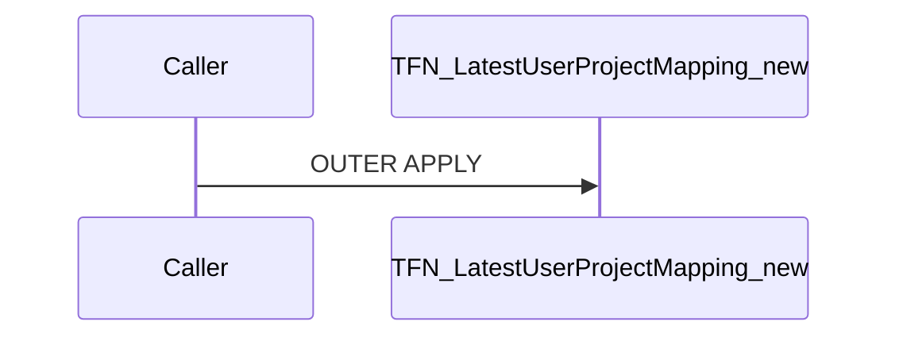
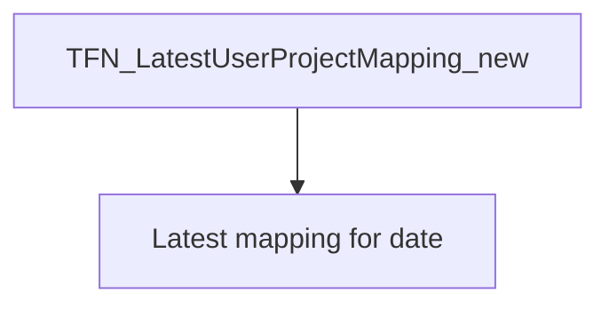

# TFN_LatestUserProjectMapping_new

## What it does

Returns the latest effective `TTSUserProjectMapping` row for an employee/project-config as of a timesheet date (temporal-aware), used when an approver modifies lines.

## Parameters

| Name | Direction | What it is for |
|---|---|---|
| Employee / ProjectConfig / date args as declared in the function | in | Resolve latest mapping |

## Call sequence

## Callers

| Object | Kind | Page |
|---|---|---|
| `SP_TS_InsModifyTheRecordByApprover` | procedure | [SP_TS_InsModifyTheRecordByApprover](/docs/database/hrm-timeport/SP_TS_InsModifyTheRecordByApprover) |

## Nested

Calls no other procedures or functions.

## Steps

In `HRMS-DATABASE/HRM-TIMEPORT/FUNCTIONS/TFN_LatestUserProjectMapping_new.sql`:

1. Read temporal user-project mapping for the employee/config/date.
2. Return the latest applicable mapping attributes.

## Tables

| Table | Read or write |
|---|---|
| `TTSUserProjectMapping` | read |

## Flow

