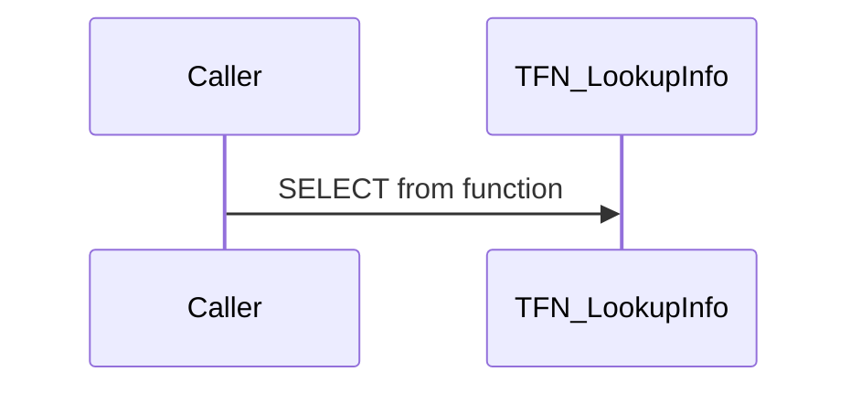
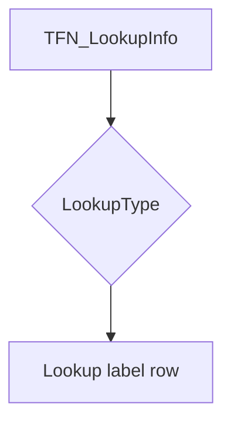

# TFN_LookupInfo

## What it does

Inline table-valued function that resolves CLIENT/PROJECT (and related) lookup labels for an employer/lookup id. Used by approver project and client filter SPs after the 75923 move away from raw TLOOKUP-only reads.

## Parameters

| Name | Direction | What it is for |
|---|---|---|
| `@LookupType` | in | e.g. CLIENT / PROJECT |
| `@EmployerId` | in | Employer |
| `@ParentId` | in | Optional parent |
| `@SubParentId` | in | Optional sub-parent |
| `@LookupId` | in | Lookup / entity id |

## Call sequence

## Callers

| Object | Kind | Page |
|---|---|---|
| `Sp_TS_GetProjectDetailsforApprover` | procedure | [Sp_TS_GetProjectDetailsforApprover](/docs/database/hrm-timeport/Sp_TS_GetProjectDetailsforApprover) |
| `Sp_TS_GetClientDetailsforApprover` | procedure | [Sp_TS_GetClientDetailsforApprover](/docs/database/hrm-timeport/Sp_TS_GetClientDetailsforApprover) |

## Nested

Calls no other procedures or functions.

## Steps

In `HRMS-DATABASE/HRM-TIMEPORT/FUNCTIONS/TFN_LookupInfo.sql`:

1. Branch by `@LookupType` to project/client (and related) sources.
2. Return Lookup_Text / Sub_Parent fields used by filter SPs.

## Tables

| Table | Read or write |
|---|---|
| `TProject` / `TClient` (and related) | read |

## Flow

