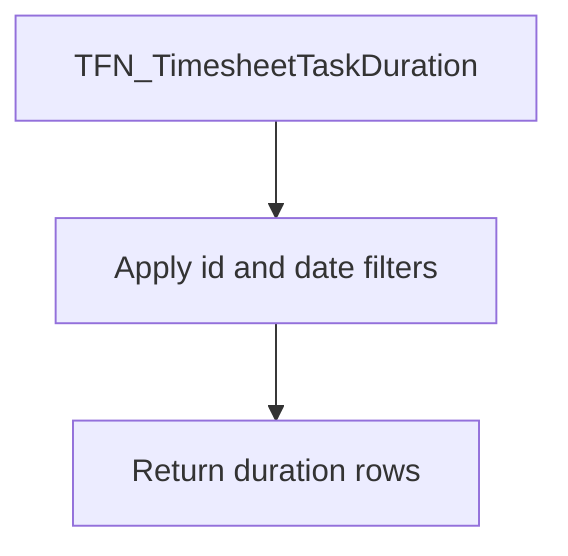

# TFN_TimesheetTaskDuration

## What it does

Inline table-valued function that returns timesheet task duration rows for employer/employee/approver/date/project/client/status filters, including duration bucket columns consumed by daily export and other TimePort reports.

## Parameters

| Name | Direction | What it is for |
|---|---|---|
| `@EmployerId` | in | Comma-separated employers |
| `@EmployeeId` | in | Optional employee |
| `@TimesheetApproverId` | in | Optional approver |
| `@StartDate` / `@EndDate` | in | Timesheet date window |
| `@ReviewFrequency` | in | Optional frequency |
| `@ClientIds` / `@ProjectIds` / `@StatusIds` | in | Optional filters |
| `@SdlcIds` / `@WorkProductTypeIds` | in | Optional filters |
| `@requestfrom` | in | Caller context |

## Call sequence

Calls no other procedures or functions (string_split helpers only).

## Callers

| Object | Kind | Page |
|---|---|---|
| `Sp_TS_ExportEmpTimeSheetReportByDaily` | procedure | [Sp_TS_ExportEmpTimeSheetReportByDaily](/docs/database/hrm-timeport/Sp_TS_ExportEmpTimeSheetReportByDaily) |

## Nested

Calls no other procedures or functions.

## Steps

1. Split optional filter strings into sets.
2. Select from timesheet/config sources filtered by employer list, dates, projects, clients, statuses, and optional approver/employee.
3. Return duration and attribute columns used by export SELECT lists.

## Tables

| Table | Read or write |
|---|---|
| `TTSEmpTimeSheet` (and related config joins in function body) | read |

## Flow

