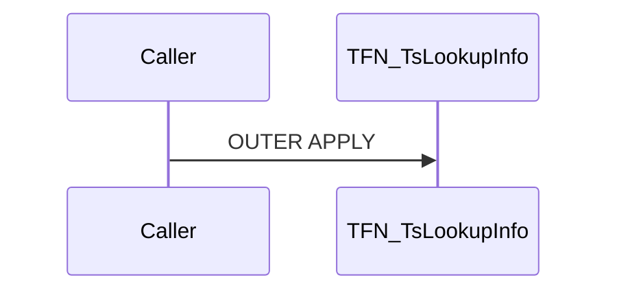
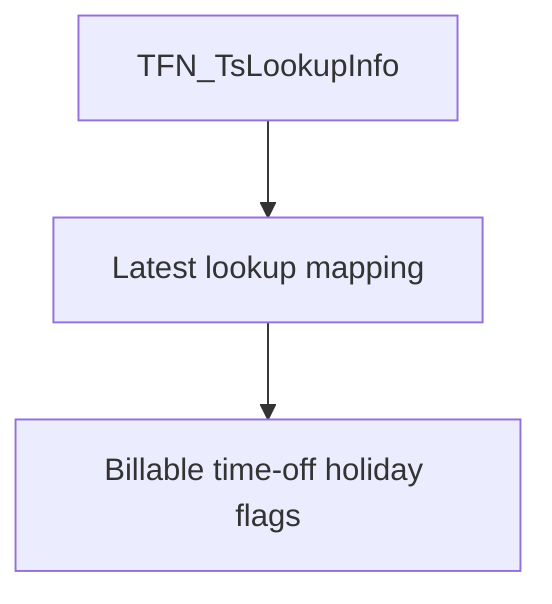

# TFN_TsLookupInfo

## What it does

Returns latest lookup-mapping info (billable / time-off / holiday flags and related) for a project config and TTS lookup id as of an effective date, used when approvers rewrite timesheet lines.

## Parameters

| Name | Direction | What it is for |
|---|---|---|
| `@EmployerId` | in | Employer |
| `@EffectiveUntil` | in | Effective date |
| `@ProjectConfigId` | in | Project config |
| `@TTSLookUpID` | in | Lookup id (e.g. work item) |
| `@SubParentId` | in | Optional sub-parent |

## Call sequence

## Callers

| Object | Kind | Page |
|---|---|---|
| `SP_TS_InsModifyTheRecordByApprover` | procedure | [SP_TS_InsModifyTheRecordByApprover](/docs/database/hrm-timeport/SP_TS_InsModifyTheRecordByApprover) |

## Nested

Calls no other procedures or functions.

## Steps

In `HRMS-DATABASE/HRM-TIMEPORT/FUNCTIONS/TFN_TsLookupInfo.sql`:

1. Resolve latest `TTSLookUpMapping` (and related) for the config/lookup/date.
2. Return IsBillable / IsTimeOff / IsHoliday style attributes.

## Tables

| Table | Read or write |
|---|---|
| `TTSLookUpMapping` | read |
| Related lookup/project tables | read |

## Flow

