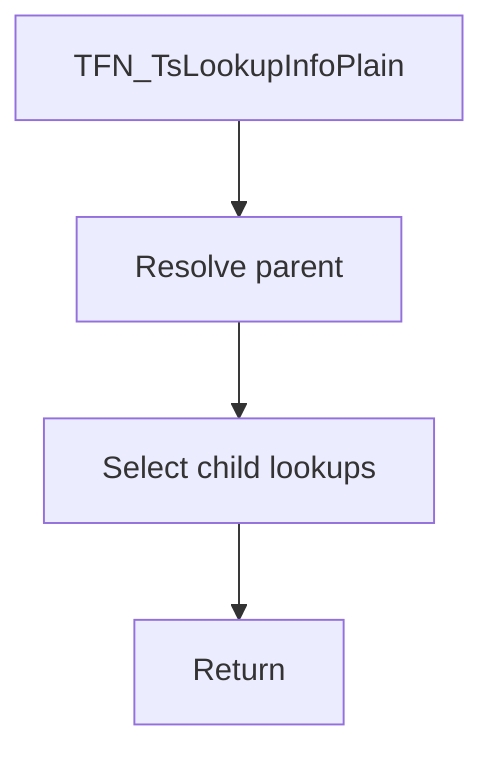

# TFN_TsLookupInfoPlain

## What it does

Returns plain TTSLOOKUP child rows for a lookup type/parent (e.g. Location) for an employer, optionally filtered by sub-parent and lookup id.

## Parameters

| Name | Direction | What it is for |
|---|---|---|
| `@LookupType` | in | Parent lookup name when `@ParentId` is null |
| `@EmployerId` | in | Employer |
| `@ParentId` | in | Optional parent lookup id |
| `@SubParentId` | in | Optional sub-parent |
| `@LookupId` | in | Optional child lookup id |

## Call sequence

Calls no other procedures or functions.

## Callers

| Object | Kind | Page |
|---|---|---|
| `Sp_TS_ExportEmpTimeSheetReportByDaily` | procedure | [Sp_TS_ExportEmpTimeSheetReportByDaily](/docs/database/hrm-timeport/Sp_TS_ExportEmpTimeSheetReportByDaily) |

## Nested

Calls no other procedures or functions.

## Steps

1. Resolve parent lookup by name or id.
2. Select matching child `TTSLOOKUP` rows for the employer with optional filters.

## Tables

| Table | Read or write |
|---|---|
| `TTSLOOKUP` | read |

## Flow

