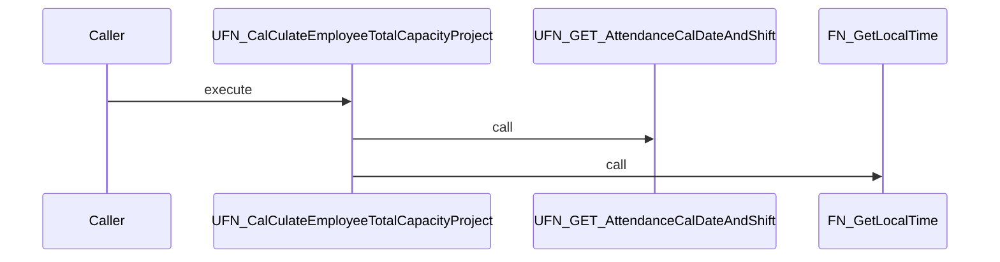
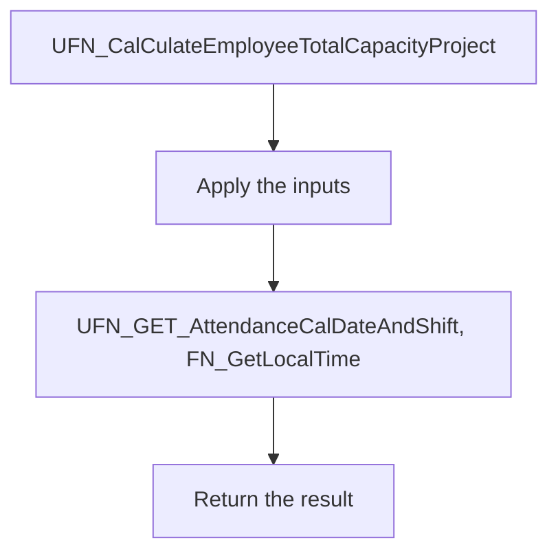

# UFN_CalCulateEmployeeTotalCapacityProject

## What it does

Helper called by a Home dashboard procedure. It reads and writes F, TEmployeeInfo, TDailyRegisterNew, RankedDates and returns that result to its caller.

## Parameters

| Name | Direction | What it is for |
|---|---|---|
| `@Employeeid` | in | Employee the Home screen is loading or acting for (`INT`) |
| `@ProjectID` | in | Input used by this procedure (`INT`) |
| `@StartDate` | in | Range start (`DATE`) |
| `@EndDate` | in | Range end (`DATE`) |

## Call sequence

## Callers

| Object | Kind | Page |
|---|---|---|
| `SP_GetTimeSheetDetailsByDateWise` | procedure | [SP_GetTimeSheetDetailsByDateWise](/docs/database/hrm-timeport/SP_GetTimeSheetDetailsByDateWise) |
| `Sp_TS_ExportEmpTimeSheetReportByDaily` | procedure | No page yet |
| `Sp_TS_GetEmpProjectDetails` | procedure | No page yet |
| `Sp_TS_GetTimeSheetDetails` | procedure | No page yet |
| `Sp_TS_GetTimeSheetStatusDetails` | procedure | No page yet |
| `TFN_TimesheetTaskDurationSummaryHistory_status` | function | No page yet |

## Nested

| Object | Kind | When | Page |
|---|---|---|---|
| `UFN_GET_AttendanceCalDateAndShift` | function | Called while this object runs | No page yet |
| `FN_GetLocalTime` | function | Called while this object runs | [FN_GetLocalTime](/docs/database/hrms/FN_GetLocalTime) |

## Steps

In `HRMS-DATABASE/HRM-TIMEPORT/FUNCTIONS/UFN_CalCulateEmployeeTotalCapacityProject.sql`:

1. Read through `UFN_GET_AttendanceCalDateAndShift`, `FN_GetLocalTime`.
2. Write `F`.
3. Read `TEmployeeInfo`, `TDailyRegisterNew`, `RankedDates`, `TWeeklyOffMaster`, `THolidayMaster`, `TOptionalHolidayRequest`, `TSHIFTMASTER`, `TRESOURCEALLOCATION`.
4. Return the result set to the caller.

## Tables

| Table | Read or write |
|---|---|
| `F` | write |
| `TEmployeeInfo` | read |
| `TDailyRegisterNew` | read |
| `RankedDates` | read |
| `TWeeklyOffMaster` | read |
| `THolidayMaster` | read |
| `TOptionalHolidayRequest` | read |
| `TSHIFTMASTER` | read |
| `TRESOURCEALLOCATION` | read |

## Flow

