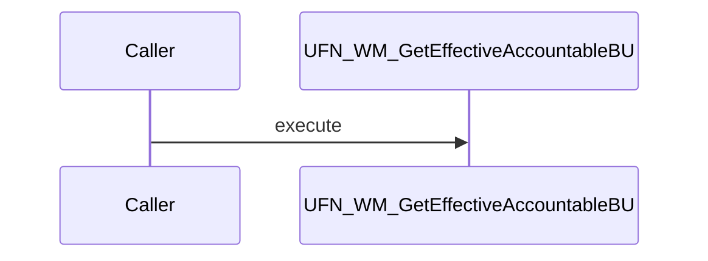
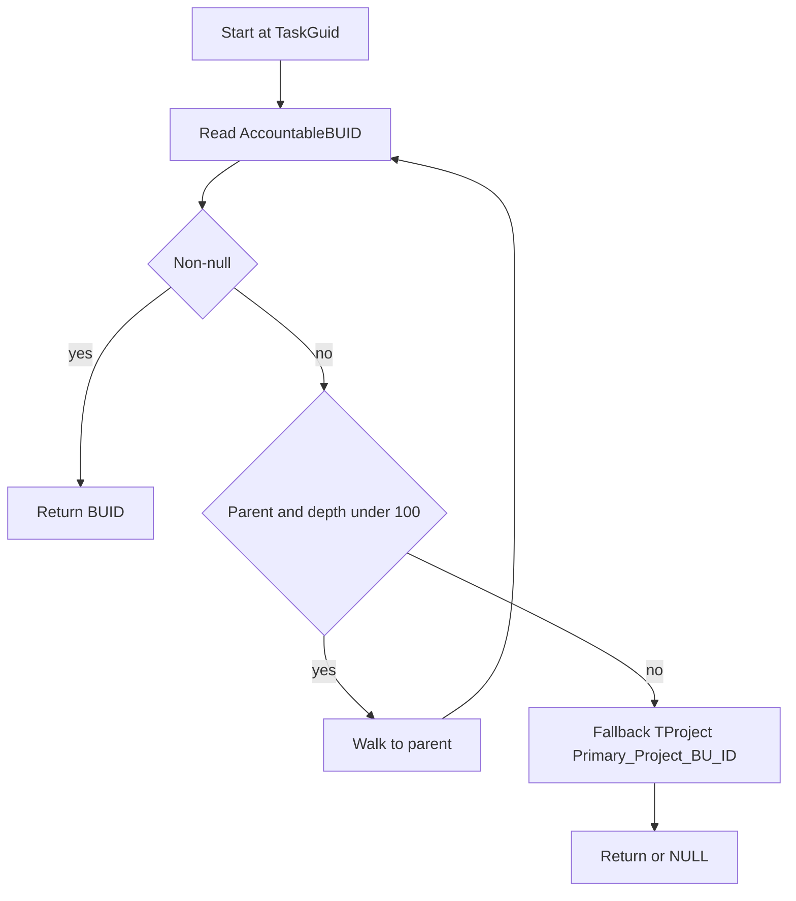

# UFN_WM_GetEffectiveAccountableBU

## What it does

Scalar resolution of a task’s effective Accountable Business Unit: walk `AccountableBUID` up the `ParentTaskGuid` chain (first non-NULL wins, depth capped at 100). If still null, fall back to the project’s `Primary_Project_BU_ID` on `TProject` (Core HRMS synonym). Returns `NULL` when nothing resolves. Used by Stage Audit `CanRollback` / rollback current-stage checks and wider HTB / task flows.

## Parameters

| Name | Direction | What it is for |
|---|---|---|
| (return) | out | Effective BU id (`INT`) |
| `@TaskGuid` | in | Task to resolve |

## Call sequence

## Callers

Called from live TIMEPORT procedures including `USP_WM_GetStageAuditTrail` and `USP_WM_RollbackHandoffBatch` (Stage Audit path). Broader HTB and task procedures also use it; Liquibase inventory of those callers is incomplete because `USP_WM_*` scripts are not under `HRM-TIMEPORT/STOREPROCEDURE`.

## Nested

None (scalar reads only).

## Steps

1. Loop from `@TaskGuid` up to 100 parents; stop when `AccountableBUID` is non-null or row missing.
2. If still null and `ProjectID` known, read `TProject.Primary_Project_BU_ID` where not deleted.
3. Return the resolved BU id or `NULL`.

## Tables

| Table | Access | What it is for |
|---|---|---|
| `TWM_Task` | read | AccountableBUID, ParentTaskGuid, ProjectID |
| `TProject` | read | Primary_Project_BU_ID fallback |

## Unresolved calls

None.

## Flow

