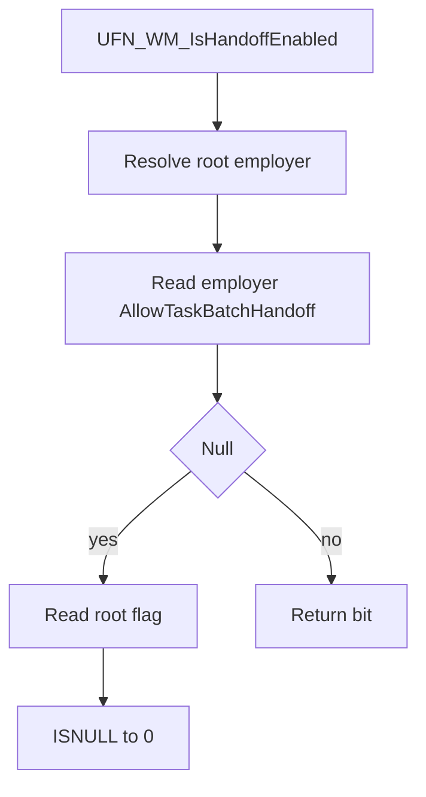

# UFN_WM_IsHandoffEnabled

## What it does

Scalar gate for Task Batch Handoff: returns whether `AllowTaskBatchHandoff` is on for an employer. Prefers the employer's own active `TWM_TaskFeatureConfig` row with `ProjectId IS NULL`, then the root employer's row. Missing config fails **closed** (`0`). Used by HTB write guards and related report flows so the employer/root fallback cannot drift from Configuration → TASK SETUP.

## Parameters

| Name | Direction | What it is for |
|---|---|---|
| `@EmployerId` | in | Employer to evaluate |

## Call sequence

Calls no other procedures or functions.

## Callers

HTB / report procedures that guard handoff (for example enqueue and decide flows). Configuration UI does not call this function directly; it writes the flag via `USP_WM_UpsertTaskFeatureConfig`.

## Nested

Calls no other procedures or functions.

## Steps

1. Resolve `@RootEmployerId` from `TEmployerDetails`.
2. Read `AllowTaskBatchHandoff` for `@EmployerId` (`ProjectId IS NULL`, active).
3. If null, read the same for `@RootEmployerId`.
4. Return `ISNULL(@Enabled, 0)`.

## Tables

| Table | Read or write |
|---|---|
| `dbo.TEmployerDetails` | read |
| `dbo.TWM_TaskFeatureConfig` | read |

## Flow

