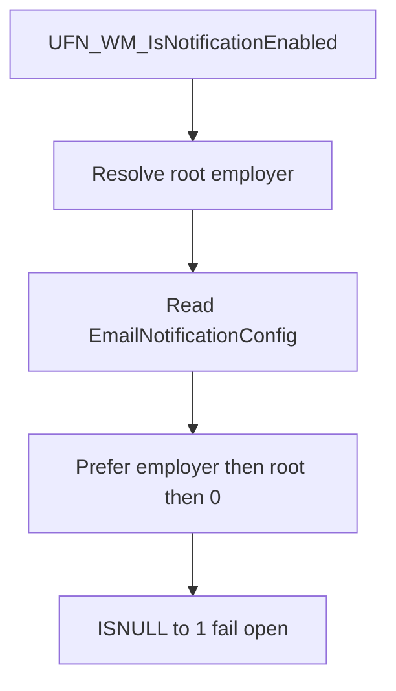

# UFN_WM_IsNotificationEnabled

## What it does

Scalar gate for task email notifications. Given `@EmployerId` and `@NotificationKey` (template name such as `TaskAtRisk`), returns whether that notification is enabled. Reads `TWM_EmailNotificationConfig` (`SettingKey = 'IsEnabled'`) with preference order employer → root employer → `EmployerId = 0`. Fails **open** (`1`) when no row exists so existing producers keep sending until an employer turns a key off. Exposed to HRMS via synonym for reminder procedures.

## Parameters

| Name | Direction | What it is for |
|---|---|---|
| `@EmployerId` | in | Employer to evaluate |
| `@NotificationKey` | in | Template / module page name |

## Call sequence

Calls no other procedures or functions.

## Callers

Notification producers and reminder procedures (for example `SP_TaskAtRiskReminderNotification`, `SP_TaskOverdueReminderNotification`, HTB enqueue). Configuration TASK SETUP historically stored JSON in `NotificationFlags`; this function no longer reads that column.

## Nested

Calls no other procedures or functions.

## Steps

1. Resolve `@RootEmployerId` from `TEmployerDetails`.
2. Select `SettingValue` from active `TWM_EmailNotificationConfig` for `@NotificationKey` / `IsEnabled` among employer, root, and `0`, ordered by preference.
3. Return `ISNULL(TRY_CONVERT(BIT, SettingValue), 1)`.

## Tables

| Table | Read or write |
|---|---|
| `dbo.TEmployerDetails` | read |
| `dbo.TWM_EmailNotificationConfig` | read |

## Flow

