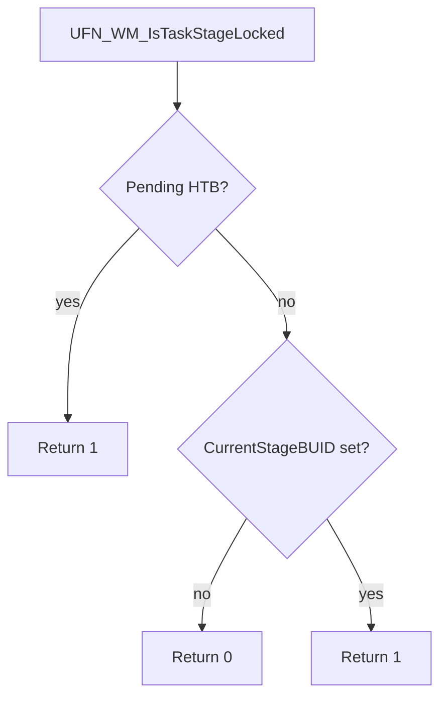

# UFN_WM_IsTaskStageLocked

## What it does

Scalar bit predicate shared by mutating Work Management procs. Returns 1 when the task is in a Pending handoff batch, or when TWM_Task.CurrentStageBUID is non-null (accepted into a different BU and not rolled back). Used by USP_WM_UpsertTaskActivityDetail to block work-log edits on locked tasks.

## Parameters

| Name | Direction | What it is for |
|---|---|---|
| @TaskGuid | in | Task to evaluate |

## Call sequence

Calls no other procedures or functions.

## Callers

| Object | Kind | Page |
|---|---|---|
| USP_WM_UpsertTaskActivityDetail | procedure | [USP_WM_UpsertTaskActivityDetail](/docs/database/hrm-timeport/USP_WM_UpsertTaskActivityDetail) |
| USP_WM_SyncActivityTimesheet | procedure | [USP_WM_SyncActivityTimesheet](/docs/database/hrm-timeport/USP_WM_SyncActivityTimesheet) |

## Nested

Calls no other procedures or functions.

## Steps

1. If the task appears in a TWM_HandoffBatchTask whose batch Status is Pending, return 1.
2. Read CurrentStageBUID from TWM_Task; null returns 0; non-null returns 1.

## Tables

| Table | Read or write |
|---|---|
| TWM_HandoffBatchTask | read |
| TWM_HandoffBatch | read |
| TWM_Task | read |

## Flow

