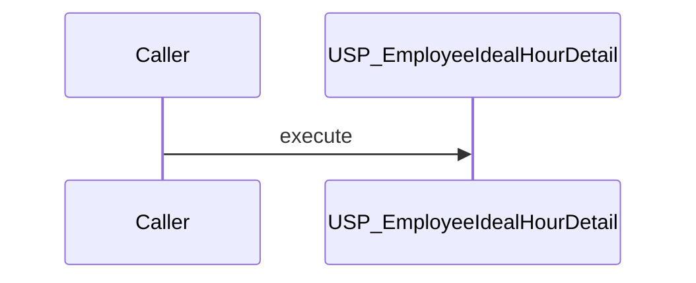
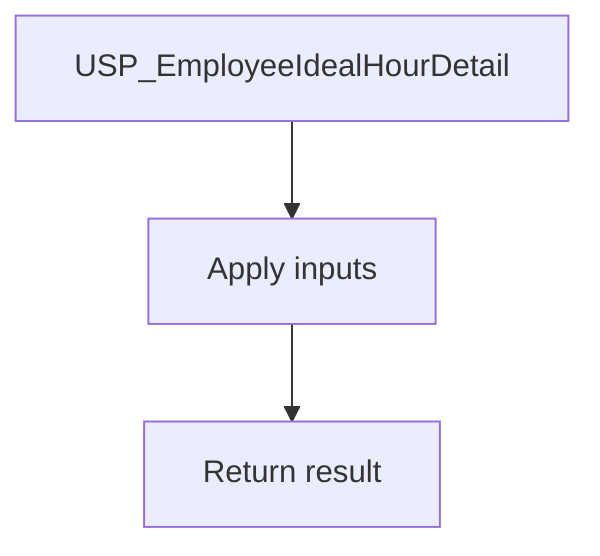

# USP_EmployeeIdealHourDetail

## What it does

Ideal-hours helper for Compliance summary. Takes `UDT_EmployeeTotalCapacity` and returns ideal working hours per employee window (nests shift detail one level deeper).

## Parameters

| Name | Direction | What it is for |
|---|---|---|
| `@UDT_EmployeeTotalCapacity` | in | TVP of employee/date windows |

## Call sequence

## Callers

| Object | Kind | Page |
|---|---|---|
| `USP_TTSEmpTimeSheet_TaskDuration` | procedure | [USP_TTSEmpTimeSheet_TaskDuration](/docs/database/hrm-timeport/USP_TTSEmpTimeSheet_TaskDuration) |

## Nested

| Object | Kind | When | Page |
|---|---|---|---|
| `USP_EmployeeShifDetail` | procedure | shift calendar expansion | — |

## Steps

In `HRMS-DATABASE/HRM-TIMEPORT/STOREPROCEDURE/USP_EmployeeIdealHourDetail.sql`:

1. Copy UDT to temp tables.
2. Call `USP_EmployeeShifDetail` for shift calendar.
3. Aggregate ideal hours and return.

## Tables

| Table | Read or write |
|---|---|
| `UDT_EmployeeTotalCapacity` | read (TVP) |

## Flow

