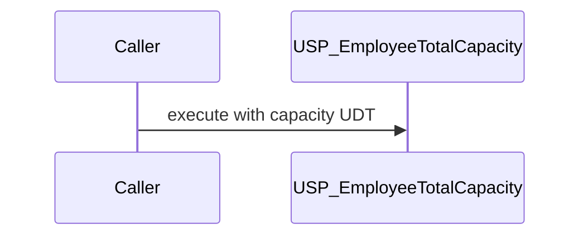
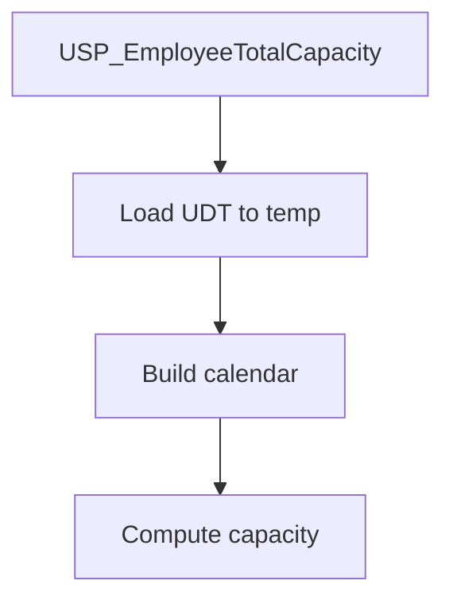

# USP_EmployeeTotalCapacity

## What it does

Given a TVP of employee/date ranges, builds a calendar working set and computes total capacity hours for summary/detail TimePort screens (used nested from summary and modified-detail SPs).

## Parameters

| Name | Direction | What it is for |
|---|---|---|
| `@UDT_EmployeeTotalCapacity` | in | TVP of Employeeid / ProjectID / StartDate / EndDate |

## Call sequence

## Callers

| Object | Kind | Page |
|---|---|---|
| `Sp_TS_GetTimeSheetSummaryNew` | procedure | [Sp_TS_GetTimeSheetSummaryNew](/docs/database/hrm-timeport/Sp_TS_GetTimeSheetSummaryNew) |
| `Sp_TS_GetModifiedTimeSheetByApprover` | procedure | [Sp_TS_GetModifiedTimeSheetByApprover](/docs/database/hrm-timeport/Sp_TS_GetModifiedTimeSheetByApprover) |

## Nested

Uses attendance/local-time helpers in OUTER APPLY (`UFN_GET_AttendanceCalDateAndShift`, `FN_GetLocalTime`) — deeper than this one-level walk; no pages written here for those.

## Steps

In `HRMS-DATABASE/HRM-TIMEPORT/STOREPROCEDURE/USP_EmployeeTotalCapacity.sql`:

1. Materialize distinct UDT rows into `#UDT`.
2. Build `#CalanderTable` across the min/max date span.
3. Apply attendance/shift helpers and return capacity aggregates for the callers.

## Tables

| Table | Read or write |
|---|---|
| Temp `#UDT` / `#CalanderTable` | write |
| Attendance/calendar sources via helpers | read |

## Flow

