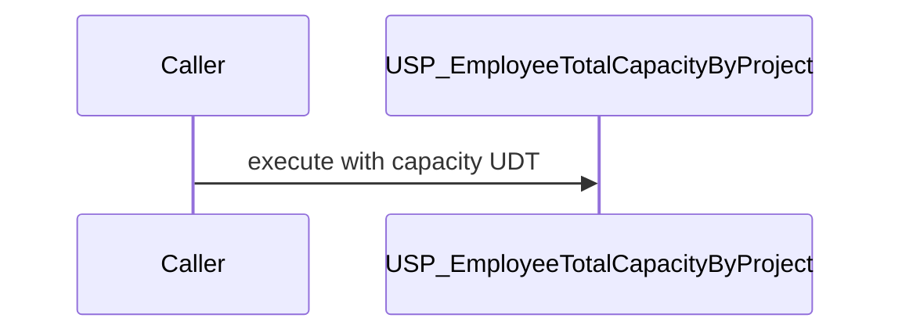
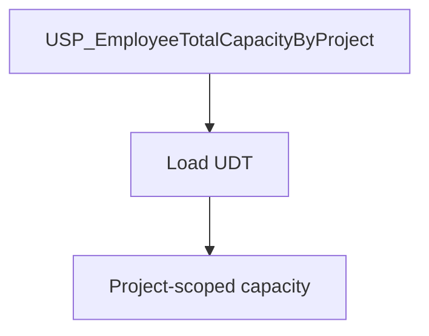

# USP_EmployeeTotalCapacityByProject

## What it does

Same capacity TVP pattern as `USP_EmployeeTotalCapacity`, but computes capacity in a project-aware form used by TimePort summary/modified-detail aggregations.

## Parameters

| Name | Direction | What it is for |
|---|---|---|
| `@UDT_EmployeeTotalCapacity` | in | TVP of Employeeid / ProjectID / StartDate / EndDate |

## Call sequence

## Callers

| Object | Kind | Page |
|---|---|---|
| `Sp_TS_GetTimeSheetSummaryNew` | procedure | [Sp_TS_GetTimeSheetSummaryNew](/docs/database/hrm-timeport/Sp_TS_GetTimeSheetSummaryNew) |
| `Sp_TS_GetModifiedTimeSheetByApprover` | procedure | [Sp_TS_GetModifiedTimeSheetByApprover](/docs/database/hrm-timeport/Sp_TS_GetModifiedTimeSheetByApprover) |

## Nested

Uses attendance/local-time helpers in OUTER APPLY (`UFN_GET_AttendanceCalDateAndShift`, `FN_GetLocalTime`) — deeper than this one-level walk.

## Steps

In `HRMS-DATABASE/HRM-TIMEPORT/STOREPROCEDURE/USP_EmployeeTotalCapacityByProject.sql`:

1. Load UDT into working temps.
2. Build calendar and project-scoped capacity.
3. Return capacity rows for the parent summary/detail SP.

## Tables

| Table | Read or write |
|---|---|
| Temp capacity/calendar tables | write |
| Attendance/calendar sources via helpers | read |

## Flow

