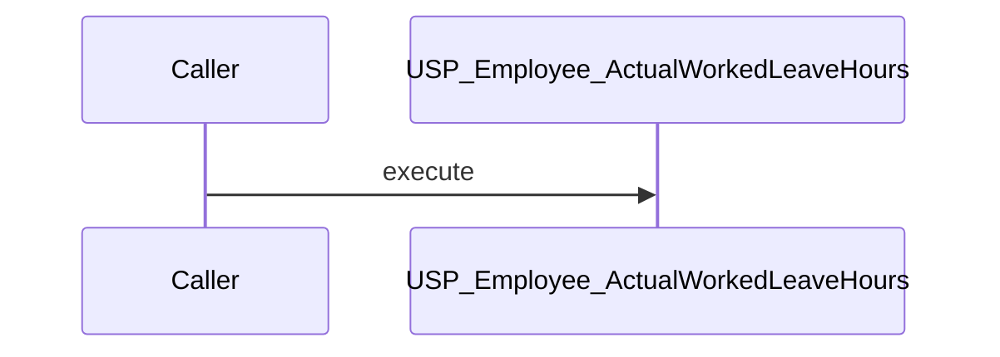
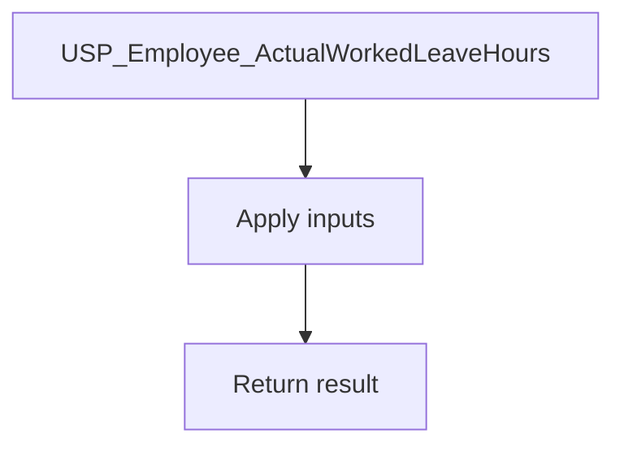

# USP_Employee_ActualWorkedLeaveHours

## What it does

Enriches Weekly/Monthly report paths with actual worked and leave hour figures for employee ids collected by the parent SP.

## Parameters

| Name | Direction | What it is for |
|---|---|---|
| `@EmployeeIds` | in | Employee id CSV / list |

## Call sequence

## Callers

| Object | Kind | Page |
|---|---|---|
| `USP_TS_GetEmpTimeSheetReportByDateRange` | procedure | [USP_TS_GetEmpTimeSheetReportByDateRange](/docs/database/hrm-timeport/USP_TS_GetEmpTimeSheetReportByDateRange) |

## Nested

| Object | Kind | When | Page |
|---|---|---|---|
| — | — | — | — |

## Steps

In `HRMS-DATABASE/HRM-TIMEPORT/STOREPROCEDURE/USP_Employee_ActualWorkedLeaveHours.sql`:

1. Accept employee id list from parent.
2. Compute or select actual worked and leave hours.
3. Return enrichment rows for the report.

## Tables

| Table | Read or write |
|---|---|
| `TEmployee` | read |

## Flow

