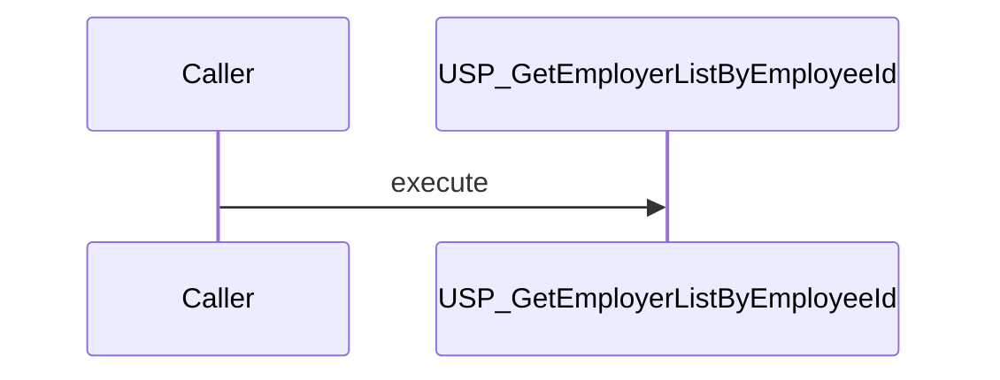
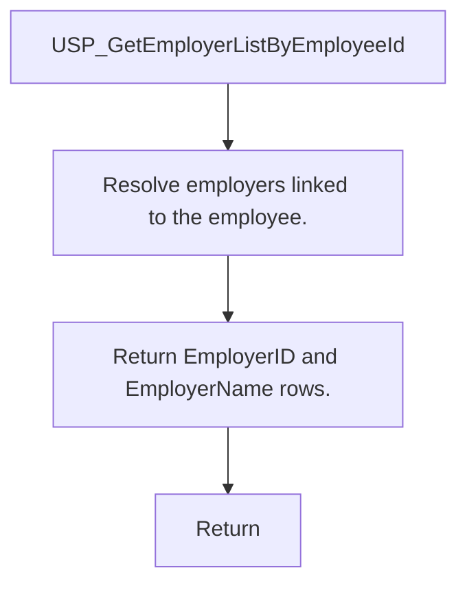

# USP_GetEmployerListByEmployeeId

## What it does

Returns the employer or organisation list the login employee can switch among on TimePort Setup Master.

## Parameters

| Name | Direction | What it is for |
|---|---|---|
| `@EmployeeId` | in | Login employee id |

## Call sequence

## Callers

Application only. timeportDAL.GetEmployerlistByEmployee.

## Nested

This object does not execute another procedure or user-defined function.

## Steps

In `HRMS-DATABASE/HRM-TIMEPORT/STOREPROCEDURE/USP_GetEmployerListByEmployeeId.sql`:

1. Resolve employers linked to the employee.
2. Return EmployerID and EmployerName rows.

## Tables

| Table | Read or write |
|---|---|
| `TEmployerDetails` | read |
| `TEmployeeInfo` | read |

## Unresolved calls

None recorded for this page.

## Flow

