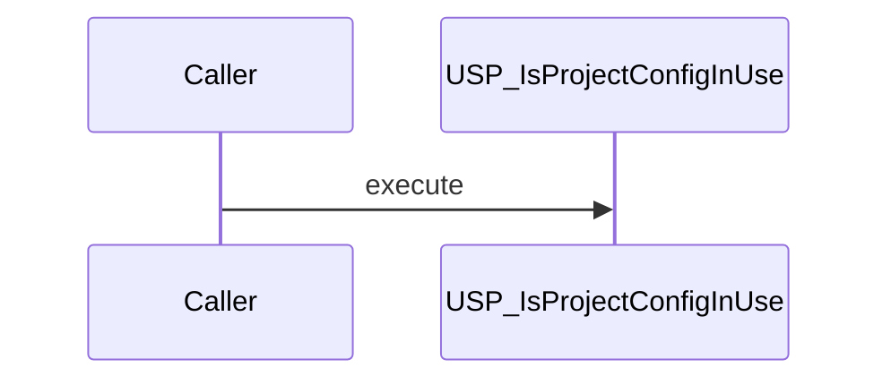
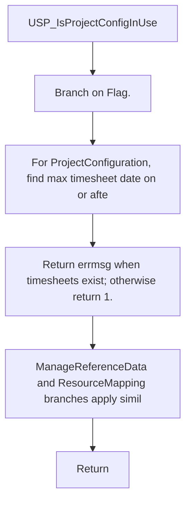

# USP_IsProjectConfigInUse

## What it does

Guards TimePort master changes. For a project config, reference mapping, or resource mapping effective date, it detects later timesheet rows and either returns 1 (allow) or an errmsg row (block).

## Parameters

| Name | Direction | What it is for |
|---|---|---|
| `@EmployerId` | in | Employer id |
| `@ProjectConfigId` | in | Project configuration id |
| `@EffectiveUntil` | in | Proposed effective date |
| `@Flag` | in | ProjectConfiguration, ManageReferenceData, or ResourceMapping |
| `@Lookup_Id` | in | Optional lookup id for reference-data flag |
| `@EmployeeID` | in | Optional employee id for resource-mapping flag |
| `@NewApproverID` | in | Optional new approver id for resource-mapping flag |

## Call sequence

## Callers

Sp_TS_UpdProjectConfiguraion, Sp_TS_InsertUpdate_TLookup, SP_TS_InsertTTSUserProjectMapping.

## Nested

This object does not execute another procedure or user-defined function.

## Steps

In `HRMS-DATABASE/HRM-TIMEPORT/STOREPROCEDURE/USP_IsProjectConfigInUse.sql`:

1. Branch on Flag.
2. For ProjectConfiguration, find max timesheet date on or after EffectiveUntil via TFN_LatestProjectConfiguration.
3. Return errmsg when timesheets exist; otherwise return 1.
4. ManageReferenceData and ResourceMapping branches apply similar timesheet or mapping checks.

## Tables

| Table | Read or write |
|---|---|
| `TTSEmpTimeSheet` | read |
| `TTSLookUpMapping` | read |
| `TTSLOOKUP` | read |
| `TSEmpTimesheetStatus` | read |

## Unresolved calls

None recorded for this page.

## Flow

