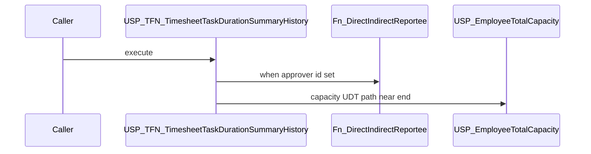
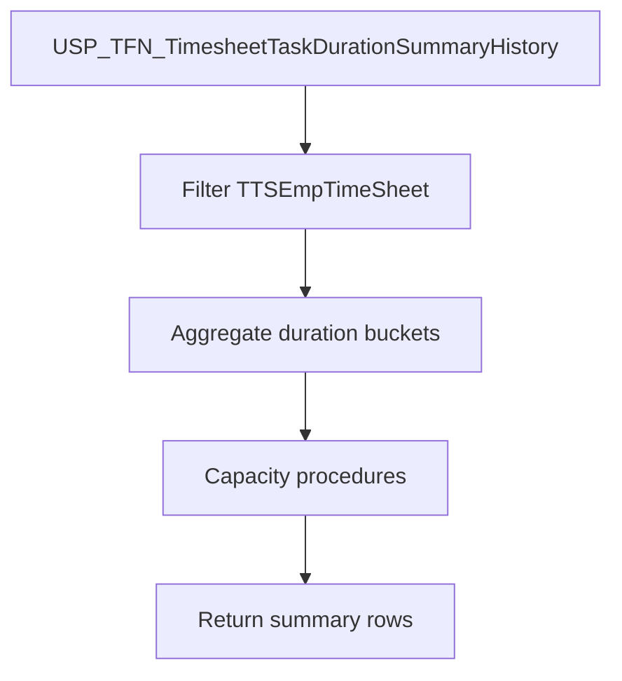

# USP_TFN_TimesheetTaskDurationSummaryHistory

## What it does

Materializes a detailed timesheet duration summary history for employer/employee/approver/date/project/client filters into the caller's temp table pattern used by weekly/monthly export. Uses reportee expansion for approver view and capacity helper procedures near the end of the script.

## Parameters

| Name | Direction | What it is for |
|---|---|---|
| `@EmployerId` | in | Comma-separated employers |
| `@EmployeeId` | in | Optional single employee |
| `@TimesheetApproverId` | in | Optional approver / reportee view |
| `@StartDate` / `@EndDate` | in | Timesheet date window |
| `@ReviewFrequency` | in | Review frequency filter |
| `@ClientIds` / `@ProjectIds` / `@StatusIds` | in | Optional filters |
| `@SdlcIds` / `@WorkProductTypeIds` | in | Optional filters |
| `@requestfrom` | in | Caller context flag |

## Call sequence

## Callers

| Object | Kind | Page |
|---|---|---|
| `Sp_TS_ExportEmpTimeSheetReportByWeeklyMonthly` | procedure | [Sp_TS_ExportEmpTimeSheetReportByWeeklyMonthly](/docs/database/hrm-timeport/Sp_TS_ExportEmpTimeSheetReportByWeeklyMonthly) |

## Nested

| Object | Kind | When | Page |
|---|---|---|---|
| `Fn_DirectIndirectReportee` | function | approver view | [Fn_DirectIndirectReportee](/docs/database/hrms/Fn_DirectIndirectReportee) |
| `USP_EmployeeTotalCapacity` | procedure | capacity fill | No page yet |
| `USP_EmployeeTotalCapacityByProject` | procedure | project capacity fill | No page yet |

## Steps

1. Build approver/reportee set via `Fn_DirectIndirectReportee` when `@TimesheetApproverId` is provided.
2. Select/filter `TTSEmpTimeSheet` (and related config/status columns) into working tables by employer, dates, projects, clients, statuses.
3. Aggregate duration buckets (task, billable, time-off, holiday, edited/non-edited variants).
4. Load `UDT_EmployeeTotalCapacity` and exec capacity procedures; join capacity onto the summary output inserted for the caller.

## Tables

| Table | Read or write |
|---|---|
| `TTSEmpTimeSheet` | read |
| Related project/config/status tables referenced in script | read |

## Flow

