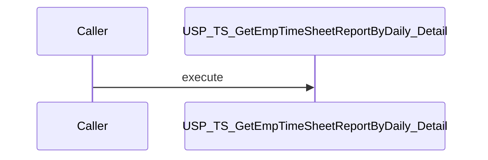
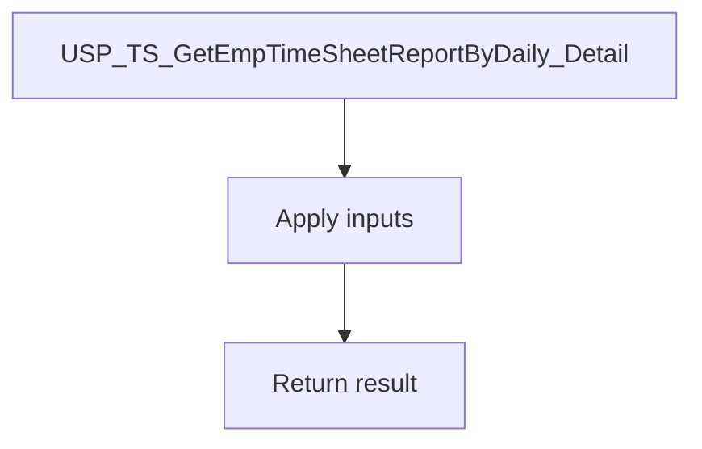

# USP_TS_GetEmpTimeSheetReportByDaily_Detail

## What it does

Returns Project Hours daily/period detail rows (task duration, billable splits, capacity) for a filter set. Uses capacity UDTs for day and duration totals.

## Parameters

| Name | Direction | What it is for |
|---|---|---|
| `@PFromDate` | in | Range start |
| `@PTodate` | in | Range end |
| `@BusinessUnit` | in | Optional BU CSV |
| `@ProjectId` | in | Project CSV |
| `@EmpId` | in | Login employee |
| `@EmployerId` | in | Primary employer |
| `@EmployerIds` | in | Employer CSV |
| `@ClientId` | in | Client CSV |
| `@ReportType` | in | Often `P` for detail |
| `@TsStatus` | in | Status CSV |
| `@InActiveEmployee` | in | Include inactive |
| `@ProjectOrgIds` | in | Project-org CSV |
| `@ClientOrgIds` | in | Client-org CSV |
| `@WorkItemTypeIds` | in | WIT CSV |

## Call sequence

## Callers

| Object | Kind | Page |
|---|---|---|
| `_application_` | TimePort API | [Report guide](/docs/guides/timeport/report) |

## Nested

| Object | Kind | When | Page |
|---|---|---|---|
| `Sp_OpenEncryptionKeys` | procedure | start | [Sp_OpenEncryptionKeys](/docs/database/hrms/Sp_OpenEncryptionKeys) |
| `SP_AdminWM_GetBusinessUnitByOrgEmployeeId` | procedure | optional BU resolve | [SP_AdminWM_GetBusinessUnitByOrgEmployeeId](/docs/database/hrms/SP_AdminWM_GetBusinessUnitByOrgEmployeeId) |
| `USP_EmployeeTotalCapacity` | procedure | day and duration capacity | [USP_EmployeeTotalCapacity](/docs/database/hrm-timeport/USP_EmployeeTotalCapacity) |
| `USP_EmployeeTotalCapacityByProject` | procedure | project capacity | [USP_EmployeeTotalCapacityByProject](/docs/database/hrm-timeport/USP_EmployeeTotalCapacityByProject) |

## Steps

In `HRMS-DATABASE/HRM-TIMEPORT/STOREPROCEDURE/USP_TS_GetEmpTimeSheetReportByDaily_Detail.sql`:

1. Open encryption keys and resolve scope.
2. Load filtered timesheet detail into temp tables.
3. Build `UDT_EmployeeTotalCapacity` and call capacity helpers for day and duration windows.
4. Return detail result set for the grid.

## Tables

| Table | Read or write |
|---|---|
| `TTSEmpTimeSheet` | read |
| `TClient` | read |
| `TProject` | read |
| `TEmployee` | read |
| `TEmployerDetails` | read |
| `TTSLOOKUP` | read |

## Flow

