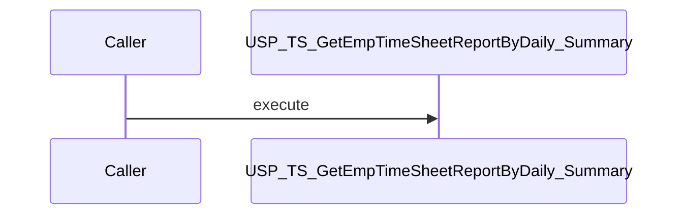
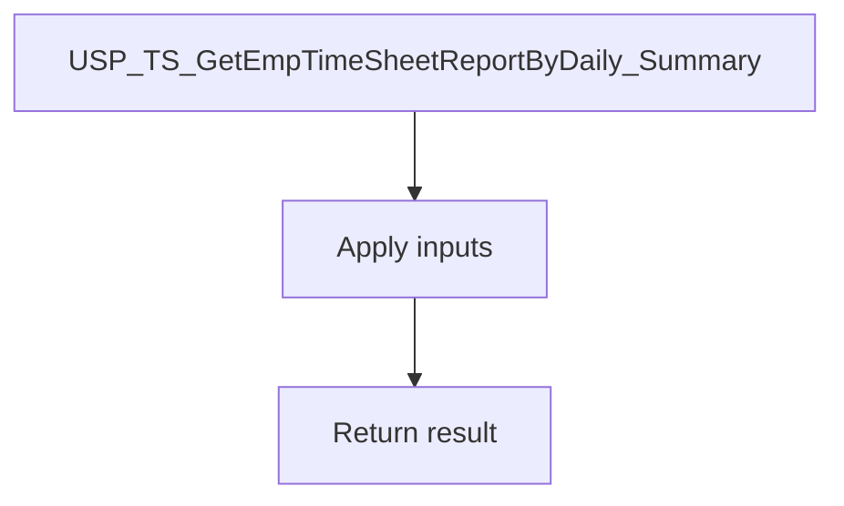

# USP_TS_GetEmpTimeSheetReportByDaily_Summary

## What it does

Builds the Project Hours Daily summary for a date range: filtered `TTSEmpTimeSheet` rows with employee/project/client labels, status, and submitted-on, scoped by reporting type and optional inactive-employee flag.

## Parameters

| Name | Direction | What it is for |
|---|---|---|
| `@PFromDate` | in | Range start |
| `@PTodate` | in | Range end |
| `@BusinessUnit` | in | Optional BU CSV |
| `@ProjectId` | in | Project id CSV |
| `@EmpId` | in | Login / scope employee |
| `@EmployerId` | in | Primary employer |
| `@EmployerIds` | in | Employer CSV |
| `@ClientId` | in | Client CSV |
| `@ReportType` | in | Usually `D` |
| `@TsStatus` | in | Status filter CSV |
| `@InActiveEmployee` | in | Include inactive |
| `@ProjectOrgIds` | in | Project-org CSV |
| `@ClientOrgIds` | in | Client-org CSV |
| `@WorkItemTypeIds` | in | WIT CSV |

## Call sequence

## Callers

| Object | Kind | Page |
|---|---|---|
| `_application_` | TimePort API | [Report guide](/docs/guides/timeport/report) |

## Nested

| Object | Kind | When | Page |
|---|---|---|---|
| `Sp_OpenEncryptionKeys` | procedure | start | [Sp_OpenEncryptionKeys](/docs/database/hrms/Sp_OpenEncryptionKeys) |
| `USP_TS_UpdateTimeSheetConfigByQueue` | procedure | when TTSConfigUpdateQueue has unprocessed rows | [USP_TS_UpdateTimeSheetConfigByQueue](/docs/database/hrm-timeport/USP_TS_UpdateTimeSheetConfigByQueue) |
| `SP_AdminWM_GetBusinessUnitByOrgEmployeeId` | procedure | optional BU resolve (may be commented) | [SP_AdminWM_GetBusinessUnitByOrgEmployeeId](/docs/database/hrms/SP_AdminWM_GetBusinessUnitByOrgEmployeeId) |

## Steps

In `HRMS-DATABASE/HRM-TIMEPORT/STOREPROCEDURE/USP_TS_GetEmpTimeSheetReportByDaily_Summary.sql`:

1. Open encryption keys.
2. Optionally flush `TTSConfigUpdateQueue` via `USP_TS_UpdateTimeSheetConfigByQueue`.
3. Resolve approver / reportee scope from reporting type.
4. Select into `#TimeSheet1` from `TTSEmpTimeSheet` joined to client/project/employee/lookup.
5. Aggregate / date-band and return summary rows.

## Tables

| Table | Read or write |
|---|---|
| `TTSEmpTimeSheet` | read |
| `TClient` | read |
| `TProject` | read |
| `TEmployee` | read |
| `TEmployeeInfo` | read |
| `TEmployerDetails` | read |
| `TTSLOOKUP` | read |
| `TTSConfigUpdateQueue` | read |
| `tuseremployee` | read |
| `tusers` | read |
| `troles` | read |

## Flow

