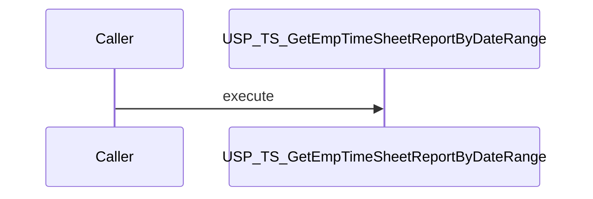
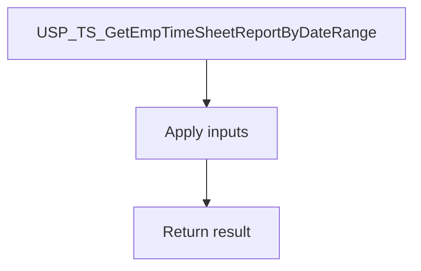

# USP_TS_GetEmpTimeSheetReportByDateRange

## What it does

Primary Weekly/Monthly Project Hours procedure. Returns timesheet duration rows (and WIT variants) for a date range with client/project/status filters; Node then groups edited vs non-edited durations.

## Parameters

| Name | Direction | What it is for |
|---|---|---|
| `@EmployerId` | in | Primary employer |
| `@EmployerIds` | in | Employer CSV |
| `@EmployeeId` | in | Login employee (JWT) |
| `@Frequency` | in | `W` / `M` / related |
| `@PFromDate` | in | Range start |
| `@PTodate` | in | Range end |
| `@BusinessUnit` | in | BU CSV |
| `@ProjectId` | in | Project CSV |
| `@ClientId` | in | Client CSV |
| `@TsStatus` | in | Status CSV |
| `@PageNumber` | in | Paging (often null from API) |
| `@FilterJson` | in | Filter JSON |
| `@PageSize` | in | Page size |
| `@TimesheetEntriesOnly` | in | Zero-hours toggle inverted in DAL |
| `@InActiveEmployee` | in | Include inactive |
| `@ProjectOrgIds` | in | Project-org CSV |
| `@ClientOrgIds` | in | Client-org CSV |
| `@SelectedWITIds` | in | WIT CSV |
| `@IncludesWIT` | in | Include WIT breakout |

## Call sequence

## Callers

| Object | Kind | Page |
|---|---|---|
| `_application_` | TimePort API | [Report guide](/docs/guides/timeport/report) |

## Nested

| Object | Kind | When | Page |
|---|---|---|---|
| `Sp_OpenEncryptionKeys` | procedure | start | [Sp_OpenEncryptionKeys](/docs/database/hrms/Sp_OpenEncryptionKeys) |
| `SP_AdminWM_GetBusinessUnitByOrgEmployeeId` | procedure | optional BU list | [SP_AdminWM_GetBusinessUnitByOrgEmployeeId](/docs/database/hrms/SP_AdminWM_GetBusinessUnitByOrgEmployeeId) |
| `USP_TS_UpdateTimeSheetConfigByQueue` | procedure | pending config queue | [USP_TS_UpdateTimeSheetConfigByQueue](/docs/database/hrm-timeport/USP_TS_UpdateTimeSheetConfigByQueue) |
| `USP_TimesheetTaskDurationSummaryHistoryReport` | procedure | duration history path | [USP_TimesheetTaskDurationSummaryHistoryReport](/docs/database/hrm-timeport/USP_TimesheetTaskDurationSummaryHistoryReport) |
| `USP_TimesheetTaskDurationSummaryWITHistoryReport` | procedure | WIT history path | [USP_TimesheetTaskDurationSummaryWITHistoryReport](/docs/database/hrm-timeport/USP_TimesheetTaskDurationSummaryWITHistoryReport) |
| `USP_Employee_ActualWorkedLeaveHours` | procedure | leave/worked hours enrichment | [USP_Employee_ActualWorkedLeaveHours](/docs/database/hrm-timeport/USP_Employee_ActualWorkedLeaveHours) |
| `SP_CloseEncryptionKey` | procedure | end | [SP_CloseEncryptionKey](/docs/database/hrms/SP_CloseEncryptionKey) |

## Steps

In `HRMS-DATABASE/HRM-TIMEPORT/STOREPROCEDURE/USP_TS_GetEmpTimeSheetReportByDateRange.sql`:

1. Open encryption keys; optionally update config queue and BU list.
2. Branch on WIT vs non-WIT and call duration history helpers.
3. Enrich with actual worked / leave hours.
4. Close encryption keys and return recordsets.

## Tables

| Table | Read or write |
|---|---|
| `TTSEmpTimeSheet` | read |
| `TEmployee` | read |
| `TClient` | read |
| `TProject` | read |
| `TEmployerDetails` | read |
| `TTSConfigUpdateQueue` | read |

## Flow

