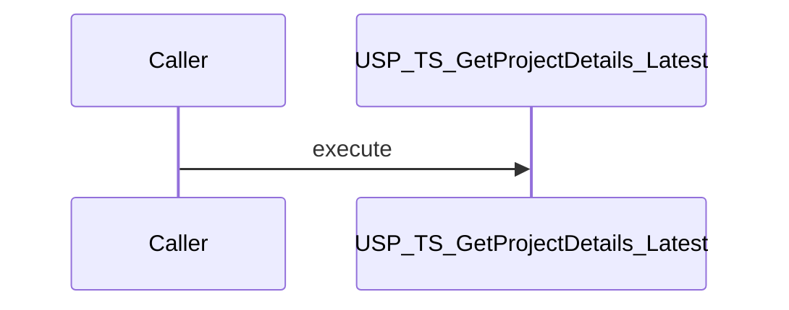
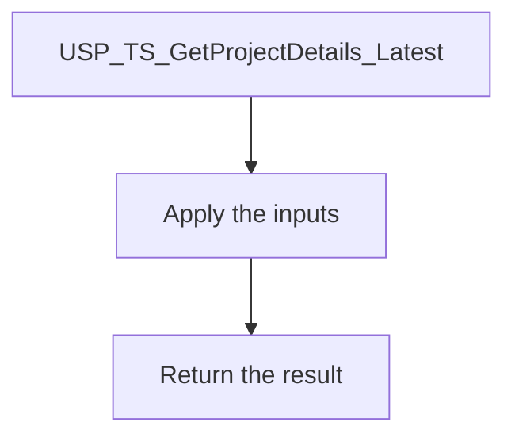

# USP_TS_GetProjectDetails_Latest

## What it does

Returns the Timeport projects the employee can chart on the Home timesheet cards for an effective date, either for the individual or for the team.

## Parameters

| Name | Direction | What it is for |
|---|---|---|
| `@pEmployerId` | in | Employer id (`int`) |
| `@pEmployeeid` | in | Employee id (`int`) |
| `@EffectiveDate` | in | Date the timesheet project list is resolved for (`date`) |
| `@ForIndividual` | in | 1 for the employee's own projects, 0 for the team list (`bit`) |

## Call sequence

## Callers

No other procedure or function under STOREPROCEDURE or FUNCTIONS executes this object.

## Nested

This object does not execute another procedure or user-defined function.

## Steps

In `HRMS-DATABASE/HRM-TIMEPORT/STOREPROCEDURE/USP_TS_GetProjectDetails_Latest.sql`:

1. Returns the Timeport projects the employee can chart on the Home timesheet cards for an effective date, either for the individual or for the team.

## Tables

| Table | Read or write |
|---|---|
| `TTSUserProjectMapping` | read |
| `TTSProjectConfiguration` | read |
| `TProject` | read |

## Flow

