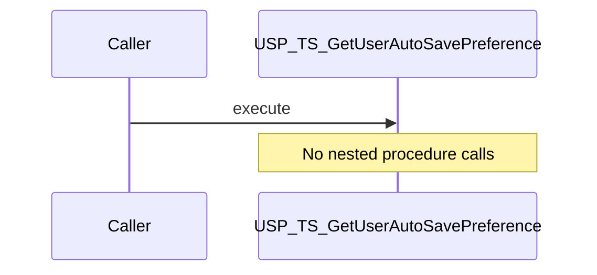
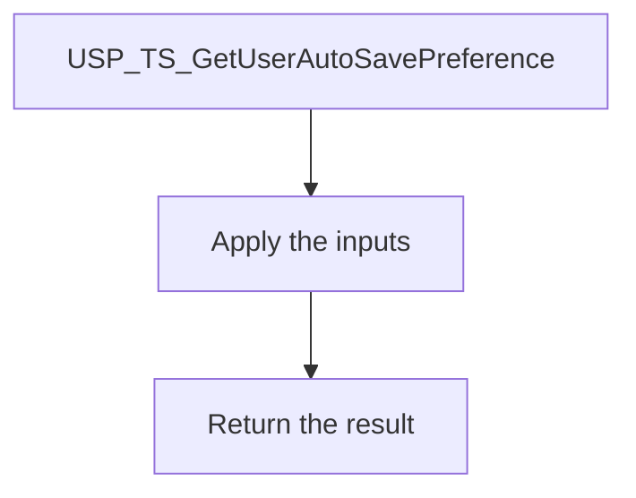

# USP_TS_GetUserAutoSavePreference

## What it does

Resolves AutoSaveBehaviour for an employer and, when the org setting is user-defined (`U`), returns the employee’s `IsEnabledAutoSave` from `TtimesheetUserPreferences`.

## Parameters

| Name | Direction | What it is for |
|---|---|---|
| `@EmployeeId` | in | Employee id |
| `@EmployerId` | in | Employer id |

## Call sequence

## Callers

Application caller: TimePort API `GetUserAutoSavePreference` for TimePort → TimeSheet when org AutoSaveBehaviour is User Define.

## Nested

| Object | Kind | When | Page |
|---|---|---|---|
| _(none)_ | — | — | — |

## Steps

In `HRMS-DATABASE/HRM-TIMEPORT/STOREPROCEDURE/USP_TS_GetUserAutoSavePreference.sql`:

1. Read `AutoSaveBehaviour` from `TtimesheetConfigOrg`.
2. If null, return default Yes with null preference.
3. If `U`, read `IsEnabledAutoSave` from `TtimesheetUserPreferences`.
4. Return display label Yes/No/User Define and optional bit.

## Tables

| Table | Read or write |
|---|---|
| `TtimesheetConfigOrg` | read |
| `TtimesheetUserPreferences` | read |

## Unresolved calls

None identified beyond the nested objects listed above.

## Flow

