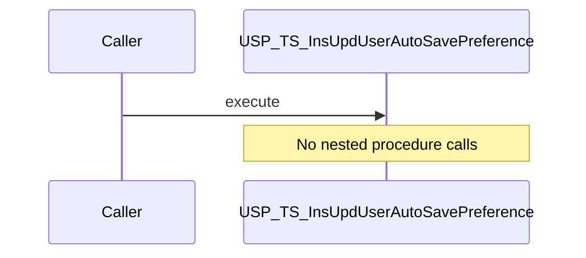
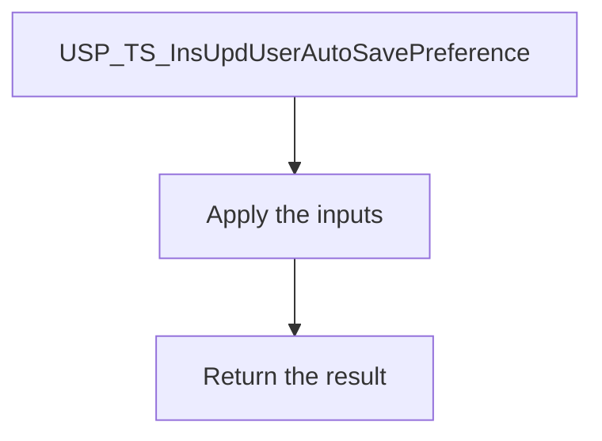

# USP_TS_InsUpdUserAutoSavePreference

## What it does

Inserts or updates the employee’s timesheet auto-save preference row used by the TimeSheet toggle.

## Parameters

| Name | Direction | What it is for |
|---|---|---|
| `@EmployeeId` | in | Employee id |
| `@ConfigOrgID` | in | TsConfigOrgID from org config |
| `@EmployerID` | in | Employer id |
| `@IsEnabledAutoSave` | in | Toggle value |

## Call sequence

## Callers

Application caller: TimePort API `SetUserAutoSavePreference` for TimePort → TimeSheet.

## Nested

| Object | Kind | When | Page |
|---|---|---|---|
| _(none)_ | — | — | — |

## Steps

In `HRMS-DATABASE/HRM-TIMEPORT/STOREPROCEDURE/USP_TS_InsUpdUserAutoSavePreference.sql`:

1. If no `TtimesheetUserPreferences` row for the employee, INSERT with config and flag.
2. Else UPDATE `IsEnabledAutoSave` and `ModifiededTime`.

## Tables

| Table | Read or write |
|---|---|
| `TtimesheetUserPreferences` | read/write |

## Unresolved calls

None identified beyond the nested objects listed above.

## Flow

