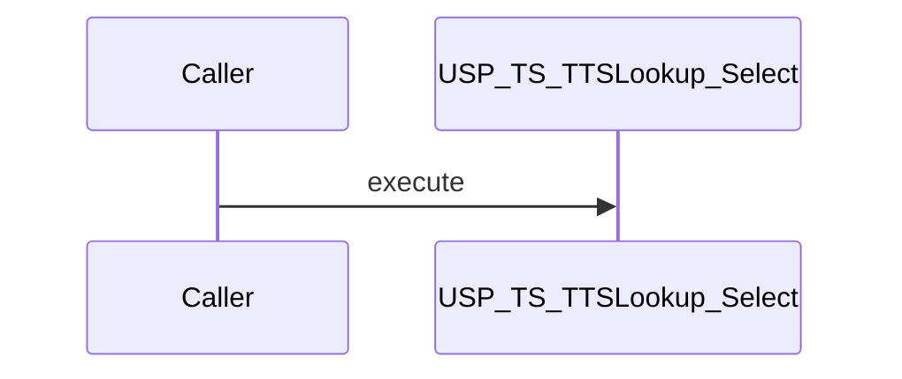
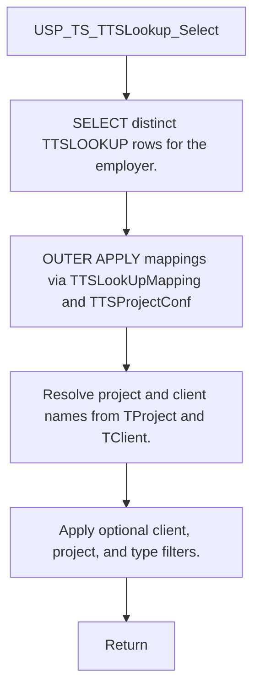

# USP_TS_TTSLookup_Select

## What it does

Searches Manage Reference Data rows by employer, optional clients, project configs, and reference types, joining lookup mappings to project and client names.

## Parameters

| Name | Direction | What it is for |
|---|---|---|
| `@pEmployerId` | in | Employer id |
| `@ClientIds` | in | Optional comma-separated client ids |
| `@ProjectConfigIds` | in | Optional project config ids |
| `@ReferenceTypeIds` | in | Optional reference type ids |
| `@EmployeeID` | in | Login employee id |

## Call sequence

## Callers

Application only. timeportDAL.GetLookupDetailsSearch.

## Nested

This object does not execute another procedure or user-defined function.

## Steps

In `HRMS-DATABASE/HRM-TIMEPORT/STOREPROCEDURE/USP_TS_TTSLookup_Select.sql`:

1. SELECT distinct TTSLOOKUP rows for the employer.
2. OUTER APPLY mappings via TTSLookUpMapping and TTSProjectConfiguration.
3. Resolve project and client names from TProject and TClient.
4. Apply optional client, project, and type filters.

## Tables

| Table | Read or write |
|---|---|
| `TTSLOOKUP` | read |
| `TTSLookUpMapping` | read |
| `TTSProjectConfiguration` | read |
| `TProject` | read |
| `TClient` | read |

## Unresolved calls

None recorded for this page.

## Flow

