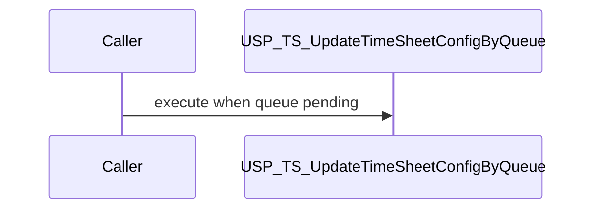
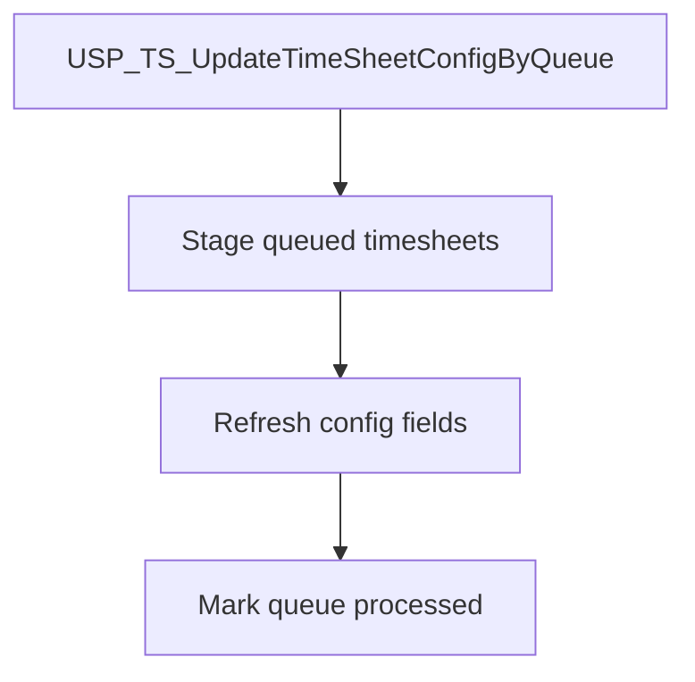

# USP_TS_UpdateTimeSheetConfigByQueue

## What it does

Drains unprocessed `TTSConfigUpdateQueue` work by staging affected `TTSEmpTimeSheet` ids and refreshing denormalized config fields (approver, billable/time-off/holiday, client, review/invoice flags) before summary reads continue.

## Parameters

None.

## Call sequence

## Callers

| Object | Kind | Page |
|---|---|---|
| `Sp_TS_GetTimeSheetSummaryNew` | procedure | [Sp_TS_GetTimeSheetSummaryNew](/docs/database/hrm-timeport/Sp_TS_GetTimeSheetSummaryNew) |

## Nested

May call further save/update helpers deeper in the script; this page records the object as nested from summary only (one level from the page call chain).

## Steps

In `HRMS-DATABASE/HRM-TIMEPORT/STOREPROCEDURE/USP_TS_UpdateTimeSheetConfigByQueue.sql`:

1. Stage timesheet ids from unprocessed queue rows into `#TTSEmpTimeSheet`.
2. Refresh config-derived columns on those timesheets.
3. Mark queue rows processed as scripted.

## Tables

| Table | Read or write |
|---|---|
| `TTSConfigUpdateQueue` | read/write |
| `TTSEmpTimeSheet` | read/write |

## Flow

