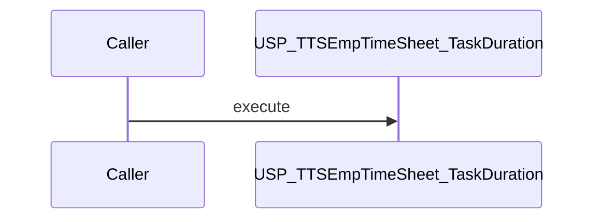
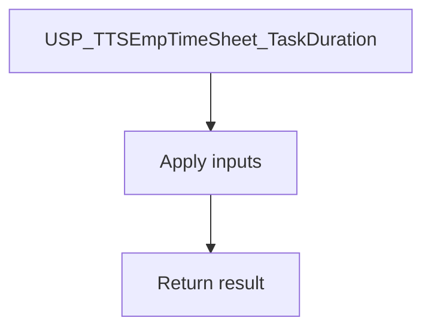

# USP_TTSEmpTimeSheet_TaskDuration

## What it does

Compliance Report summary source. Returns task-duration rows (and capacity / ideal hours) for employees in scope so Node can group by employee-period and filter less/flat/greater than allocated hours.

## Parameters

| Name | Direction | What it is for |
|---|---|---|
| `@EmployerId` | in | Primary employer |
| `@EmployerIds` | in | Employer CSV |
| `@LoginEmployeeId` | in | Login employee |
| `@StartDate` | in | Range start |
| `@EndDate` | in | Range end |
| `@ReportType` | in | `W`/`M` frequency |
| `@TimesheetEntriesOnly` | in | Entries-only flag |
| `@EmployeeIds` | in | Employee CSV |
| `@ClientIds` | in | Client CSV |
| `@ProjectIds` | in | Project CSV |
| `@BusinessUnit` | in | BU CSV |
| `@InActiveEmployee` | in | Include inactive |
| `@ClientOrgtIds` | in | Client-org CSV |
| `@ProjectOrgIds` | in | Project-org CSV |

## Call sequence

## Callers

| Object | Kind | Page |
|---|---|---|
| `_application_` | TimePort API | [Report guide](/docs/guides/timeport/report) |

## Nested

| Object | Kind | When | Page |
|---|---|---|---|
| `Sp_OpenEncryptionKeys` | procedure | start | [Sp_OpenEncryptionKeys](/docs/database/hrms/Sp_OpenEncryptionKeys) |
| `USP_TS_UpdateTimeSheetConfigByQueue` | procedure | pending queue | [USP_TS_UpdateTimeSheetConfigByQueue](/docs/database/hrm-timeport/USP_TS_UpdateTimeSheetConfigByQueue) |
| `SP_AdminWM_GetBusinessUnitByOrgEmployeeId` | procedure | optional BU | [SP_AdminWM_GetBusinessUnitByOrgEmployeeId](/docs/database/hrms/SP_AdminWM_GetBusinessUnitByOrgEmployeeId) |
| `USP_TimesheetTaskDurationSummaryHistoryReport` | procedure | duration history | [USP_TimesheetTaskDurationSummaryHistoryReport](/docs/database/hrm-timeport/USP_TimesheetTaskDurationSummaryHistoryReport) |
| `USP_EmployeeIdealHourDetail` | procedure | ideal hours UDT | [USP_EmployeeIdealHourDetail](/docs/database/hrm-timeport/USP_EmployeeIdealHourDetail) |
| `SP_CloseEncryptionKey` | procedure | end | [SP_CloseEncryptionKey](/docs/database/hrms/SP_CloseEncryptionKey) |

## Steps

In `HRMS-DATABASE/HRM-TIMEPORT/STOREPROCEDURE/USP_TTSEmpTimeSheet_TaskDuration.sql`:

1. Open keys; flush config queue if needed.
2. Resolve scope and pull duration history.
3. Compute ideal hours via `USP_EmployeeIdealHourDetail`.
4. Return duration and capacity-related result sets; close keys.

## Tables

| Table | Read or write |
|---|---|
| `TTSEmpTimeSheet` | read |
| `TEmployee` | read |
| `TEmployerDetails` | read |
| `TTSConfigUpdateQueue` | read |

## Flow

