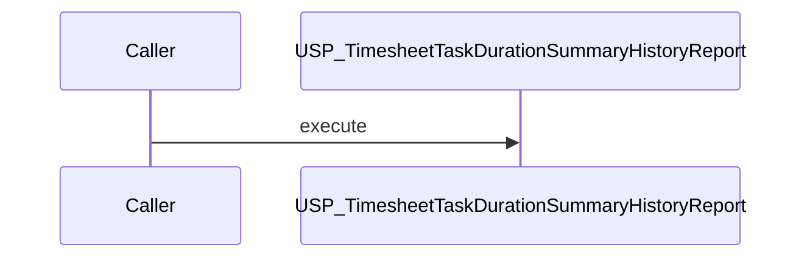
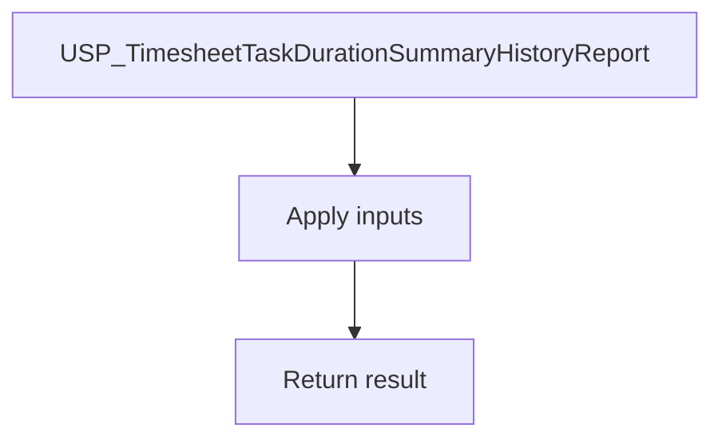

# USP_TimesheetTaskDurationSummaryHistoryReport

## What it does

Shared duration-history helper used by Weekly/Monthly and Compliance summary paths. Filters `TTSEmpTimeSheet` by employer/employee/date/client/project/status and returns duration fields including edited-admin variants.

## Parameters

| Name | Direction | What it is for |
|---|---|---|
| `@EmployerId` | in | Employer CSV |
| `@EmployeeId` | in | Employee CSV |
| `@TimesheetApproverId` | in | Optional approver scope |
| `@StartDate` | in | Start |
| `@EndDate` | in | End |
| `@ReviewFrequency` | in | Frequency |
| `@ClientIds` | in | Client CSV |
| `@ProjectIds` | in | Project CSV |
| `@StatusIds` | in | Status CSV |
| `@SdlcIds` | in | SDLC CSV |
| `@WorkProductTypeIds` | in | WPT CSV |
| `@requestfrom` | in | Caller flag |

## Call sequence

## Callers

| Object | Kind | Page |
|---|---|---|
| `USP_TS_GetEmpTimeSheetReportByDateRange` | procedure | [USP_TS_GetEmpTimeSheetReportByDateRange](/docs/database/hrm-timeport/USP_TS_GetEmpTimeSheetReportByDateRange) |
| `USP_TTSEmpTimeSheet_TaskDuration` | procedure | [USP_TTSEmpTimeSheet_TaskDuration](/docs/database/hrm-timeport/USP_TTSEmpTimeSheet_TaskDuration) |

## Nested

| Object | Kind | When | Page |
|---|---|---|---|
| — | — | — | — |

## Steps

In `HRMS-DATABASE/HRM-TIMEPORT/STOREPROCEDURE/USP_TimesheetTaskDurationSummaryHistoryReport.sql`:

1. Optionally expand reportee list from approver.
2. Select filtered timesheet duration history rows.
3. Return result set to the parent report SP.

## Tables

| Table | Read or write |
|---|---|
| `TTSEmpTimeSheet` | read |
| `TEmployee` | read |

## Flow

