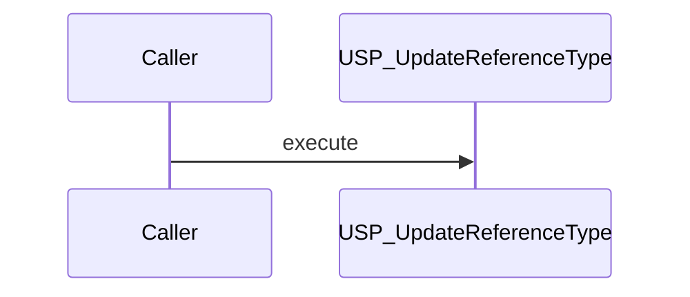
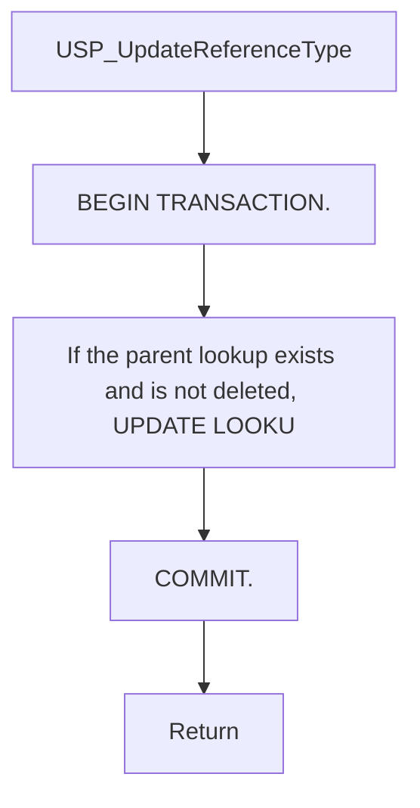

# USP_UpdateReferenceType

## What it does

Renames a top-level TimePort reference type (TTSLOOKUP parent) for an employer.

## Parameters

| Name | Direction | What it is for |
|---|---|---|
| `@Employerid` | in | Employer id |
| `@ReferenceTypeId` | in | Lookup id with Lookup_Parent_ID = 0 |
| `@ReferenceTypeText` | in | New display name |

## Call sequence

## Callers

Application only. timeportDAL.UpdateReferenceType.

## Nested

This object does not execute another procedure or user-defined function.

## Steps

In `HRMS-DATABASE/HRM-TIMEPORT/STOREPROCEDURE/USP_UpdateReferenceType.sql`:

1. BEGIN TRANSACTION.
2. If the parent lookup exists and is not deleted, UPDATE LOOKUP_NAME.
3. COMMIT.

## Tables

| Table | Read or write |
|---|---|
| `TTSLOOKUP` | write |

## Unresolved calls

None recorded for this page.

## Flow

