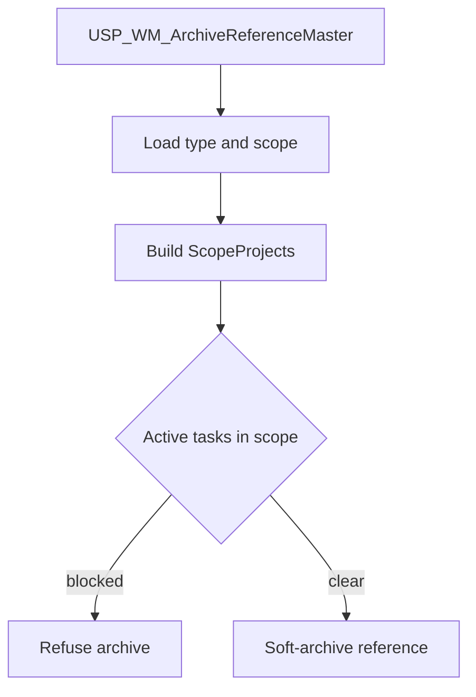

# USP_WM_ArchiveReferenceMaster

## What it does

Archives a `TWM_ReferenceMaster` value for Configuration → **REFERENCE DATA** when it is not still in use by active tasks in the row's definition scope. Scope is the row's project when set; else projects under the business-unit subtree; else the employer's projects; global (`EmployerId = 0`) rows are unrestricted (any active task can block). Uses `TWM_ReferenceMetaData` for the reference type. Soft-archives the reference (and related history patterns) when in-use checks pass.

## Parameters

| Name | Direction | What it is for |
|---|---|---|
| `@ReferenceID` | in | Reference row to archive |
| `@Employeeid` | in | Actor performing the archive |

## Call sequence

Calls no other procedures or functions (scope built with CTEs and temp tables only).

## Callers

Application caller: Work Management API archive action for Configuration → REFERENCE DATA. Catalog also lists related archive variants (`USP_WM_ArchiveReferenceMaster_V1`, `SP_WM_ArchiveReferenceMaster`).

## Nested

Calls no other procedures or functions.

## Steps

1. Load `@RefID`, `@RefType`, and scope columns from `TWM_ReferenceMaster` joined to `TWM_ReferenceMetaData`.
2. Build `#ScopeProjects` from project id, BU subtree via `TOrgHierarchyDetails` + `TProject`, employer projects, or mark unrestricted for global rows.
3. Run type-specific in-use checks against active `TWM_Task` (and related) limited to `#ScopeProjects` unless unrestricted.
4. When clear, archive the reference row (set inactive / history) for `@Employeeid`.

## Tables

| Table | Read or write |
|---|---|
| `dbo.TWM_ReferenceMaster` | read and write |
| `dbo.TWM_ReferenceMetaData` | read |
| `dbo.TOrgHierarchyDetails` | read |
| `dbo.TProject` | read |
| `dbo.TWM_Task` | read |

## Flow

