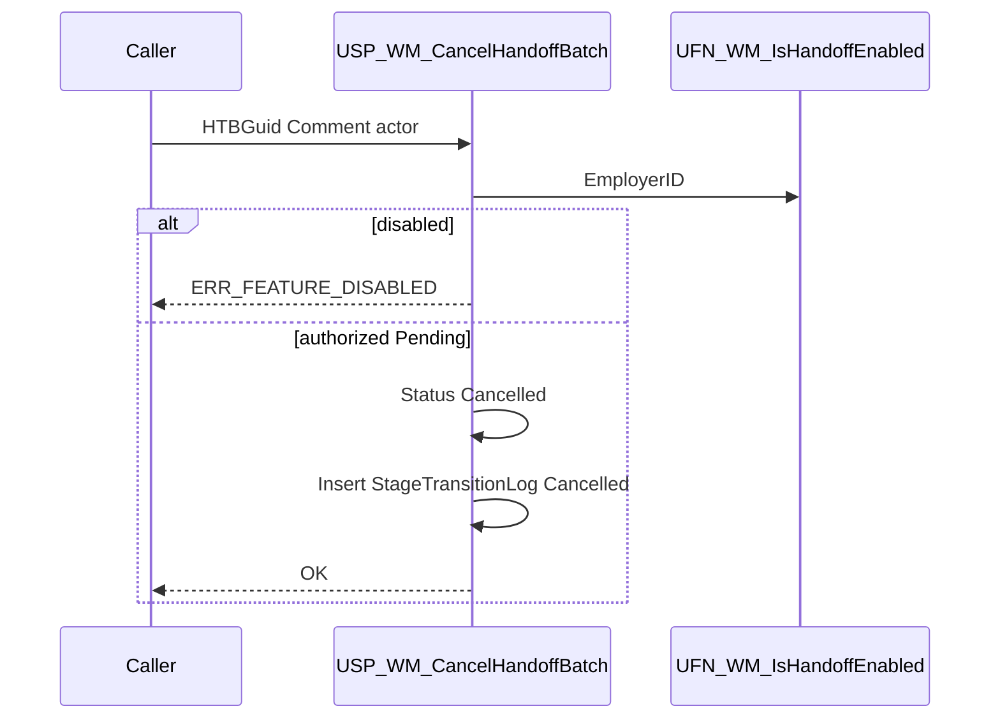
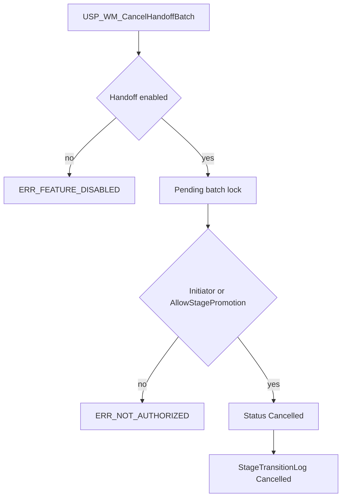

# USP_WM_CancelHandoffBatch

## What it does

Sender-side withdrawal of a **Pending** HTB (Stage Approvals Outgoing). Sets status **Cancelled**, writes `TWM_StageTransitionLog`, and does not change task stages (same unlock effect as reject). Authorized for the batch initiator or a sending-BU manager with `AllowStagePromotion`. Comment is optional. Feature-flag gated like other HTB writes.

## Parameters

| Name | Direction | What it is for |
|---|---|---|
| `@HTBGuid` | in | Batch public id |
| `@Comment` | in | Optional cancel comment |
| `@ActorEmployeeID` | in | Cancelling employee |
| `@ActorBUID` | in | Caller’s asserted org BU |
| `@EmployerID` | in | Tenant employer |

## Call sequence

## Callers

Work Management API cancel path used by Stage Approvals Outgoing (controller not in SourceCode checkout).

## Nested

| Object | Kind | When | Page |
|---|---|---|---|
| `UFN_WM_IsHandoffEnabled` | function | Before any write | [UFN_WM_IsHandoffEnabled](/docs/database/hrm-timeport/UFN_WM_IsHandoffEnabled) |

## Steps

1. Definition lives in live DEV `HRM_CL_TIMEPORT` (no Liquibase script in this checkout).
2. Abort when handoff feature is off.
3. Lock batch by `HTBGuid` + `EmployerID`; require `Pending`.
4. Authorize initiator **or** (`@ActorBUID = FromBUID` and `AllowStagePromotion`).
5. Set `Status = Cancelled` with decision audit columns.
6. Insert `TWM_StageTransitionLog` event `Cancelled`; return `OK`.

## Tables

| Table | Read or write |
|---|---|
| `TWM_HandoffBatch` | read/write |
| `TWM_HandoffBatchTask` | read |
| `TWM_StageTransitionLog` | write |
| `TWM_TAccessGroupMembers` | read |
| `TWM_TAccessGroupPermissions` | read |

## Flow

