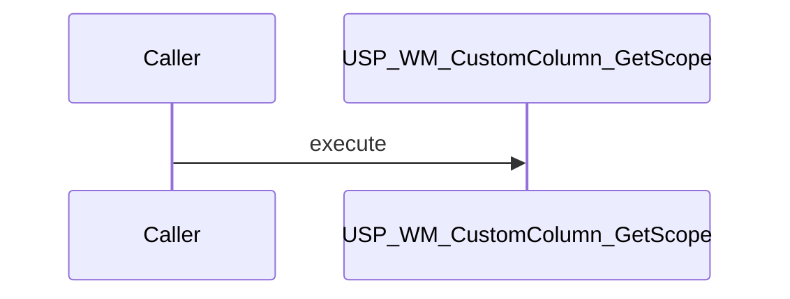
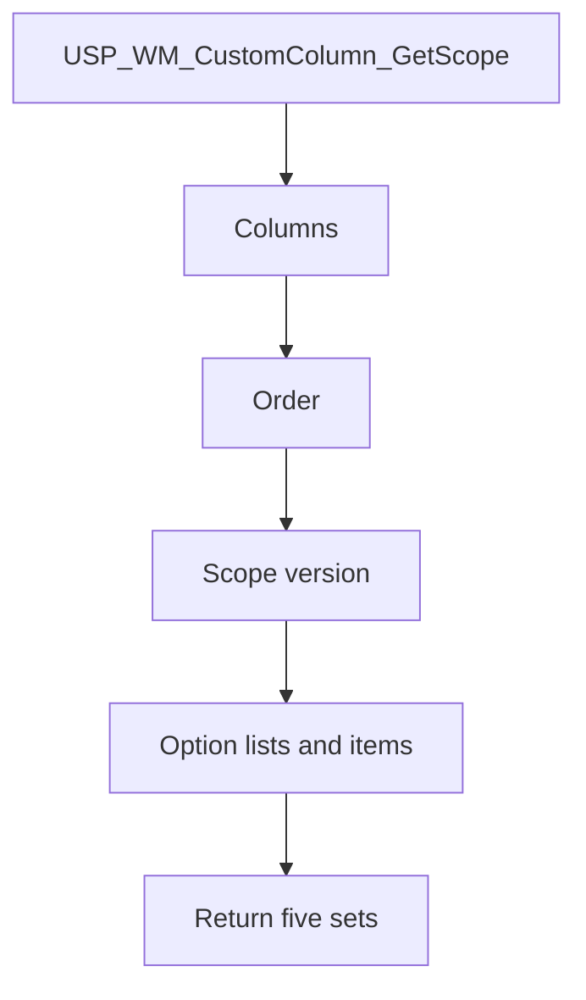

# USP_WM_CustomColumn_GetScope

## What it does

Returns five recordsets for custom-column scope: active columns, column order (with anchors), scope version, referenced option lists, and option items.

## Parameters

| Name | Direction | What it is for |
|---|---|---|
| `@EmployerID` | in | Employer id (`INT`) |
| `@EntityType` | in | Entity type key (`VARCHAR(50)`) |
| `@ProjectID` | in | Optional project scope (`INT`, default NULL) |
| `@EmployeeID` | in | Optional owner filter for user-scoped columns (`INT`, default NULL) |

## Call sequence

## Callers

Catalog `GET /v1/custom-columns` for Tasks.

## Nested

This object does not execute another procedure.

## Steps

In live DEV `HRM_CL_TIMEPORT.dbo.USP_WM_CustomColumn_GetScope`:

1. Returns active `TWM_CustomColumn` rows for employer/entity/project (honoring user-scope owner).
2. Returns `TWM_ColumnOrder` including anchor columns.
3. Returns `TWM_ScopeVersion` (0 when missing).
4. Returns referenced `TWM_OptionList` and their `TWM_OptionListItem` rows.

## Tables

| Table | Read or write |
|---|---|
| `TWM_CustomColumn` | read |
| `TWM_ColumnOrder` | read |
| `TWM_ScopeVersion` | read |
| `TWM_OptionList` | read |
| `TWM_OptionListItem` | read |

## Unresolved calls

None.

## Flow

