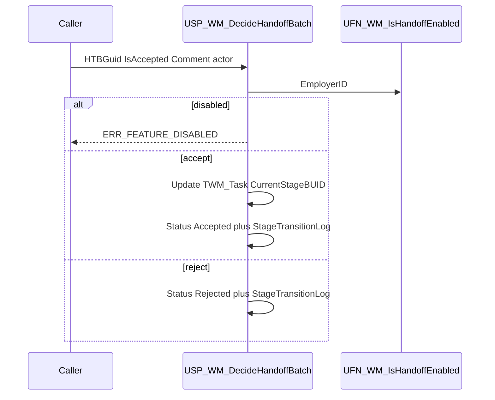
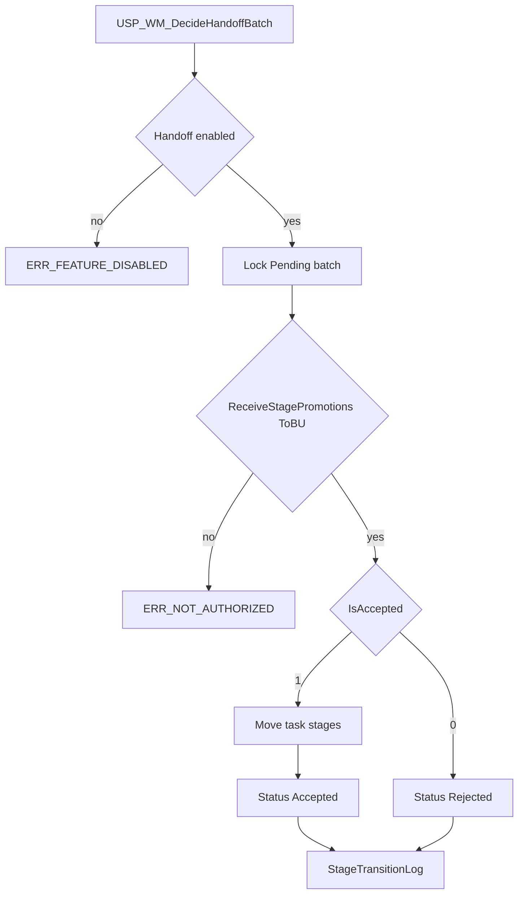

# USP_WM_DecideHandoffBatch

## What it does

Receiving-BU decision for a Pending HTB. Accept moves every batch task’s `CurrentStageBUID` to `ToBUID` and sets batch status **Accepted**. Reject requires a comment, leaves task stages unchanged, and sets **Rejected**. Both paths insert `TWM_StageTransitionLog`. Guards on feature flag, tenant, Pending status, destination BU still active (accept), and `ReceiveStagePromotions` in the receiving BU.

## Parameters

| Name | Direction | What it is for |
|---|---|---|
| `@HTBGuid` | in | Batch public id |
| `@IsAccepted` | in | `1` accept, `0` reject |
| `@Comment` | in | Optional on accept; required on reject |
| `@ActorEmployeeID` | in | Deciding employee |
| `@ActorBUID` | in | Caller’s asserted org BU (must equal `ToBUID`) |
| `@EmployerID` | in | Tenant employer |

## Call sequence

## Callers

Work Management API decide path used by Stage Approvals Incoming actions (controller not in SourceCode checkout).

## Nested

| Object | Kind | When | Page |
|---|---|---|---|
| `UFN_WM_IsHandoffEnabled` | function | Before any write | [UFN_WM_IsHandoffEnabled](/docs/database/hrm-timeport/UFN_WM_IsHandoffEnabled) |

## Steps

1. Definition lives in live DEV `HRM_CL_TIMEPORT` (no Liquibase script in this checkout).
2. Abort with `ERR_FEATURE_DISABLED` when `UFN_WM_IsHandoffEnabled` is 0.
3. Lock batch by `HTBGuid` + `EmployerID`; require `Status = Pending`.
4. Reject path requires non-blank `@Comment` (`ERR_REASON_REQUIRED`).
5. Authorize `@ActorBUID = ToBUID` and active System group with `ReceiveStagePromotions`.
6. Accept: destination BU must be active; update `TWM_Task.CurrentStageBUID`; set batch Accepted.
7. Reject: set batch Rejected only.
8. Insert `TWM_StageTransitionLog` (`Accepted` or `Rejected`) with task metadata JSON; return `OK`.

## Tables

| Table | Read or write |
|---|---|
| `TWM_HandoffBatch` | read/write |
| `TWM_HandoffBatchTask` | read |
| `TWM_Task` | write on accept |
| `TWM_StageTransitionLog` | write |
| `TWM_TAccessGroupMembers` | read |
| `TWM_TAccessGroupPermissions` | read |
| `TOrgHierarchyDetails` | read (destination active check) |

## Flow

