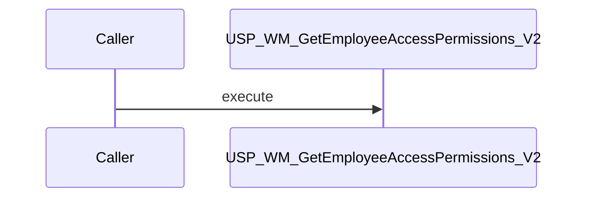
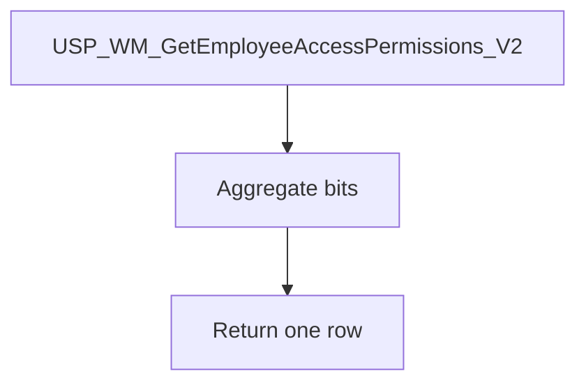

# USP_WM_GetEmployeeAccessPermissions_V2

## What it does

Aggregates Create/Update/View and stage handoff bits across the employee access groups plus virtual groups.

## Parameters

| Name | Direction | What it is for |
|---|---|---|
| `@EmployeeID` | in | Employee id (`INT`) |
| `@EmployerID` | in | Optional employer filter (`INT`, default NULL) |

## Call sequence

## Callers

Work Management Tasks permission bootstrap (catalog).

## Nested

This object does not execute another procedure.

## Steps

In live DEV `HRM_CL_TIMEPORT.dbo.USP_WM_GetEmployeeAccessPermissions_V2`:

1. Sets `READ UNCOMMITTED`.
2. Aggregates MAX permission bits from `TWM_TAccessGroupPermissions` for the employee’s groups and virtual groups.

## Tables

| Table | Read or write |
|---|---|
| `TWM_TAccessGroupPermissions` | read |
| `TWM_TAccessGroupMembers` | read |

## Unresolved calls

None.

## Flow

