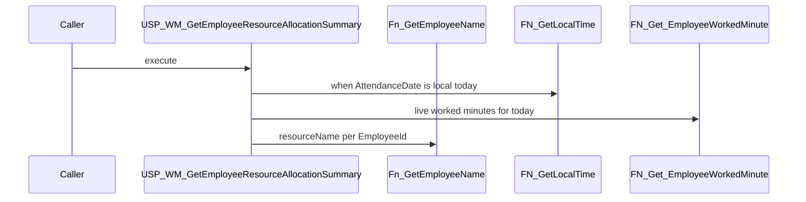
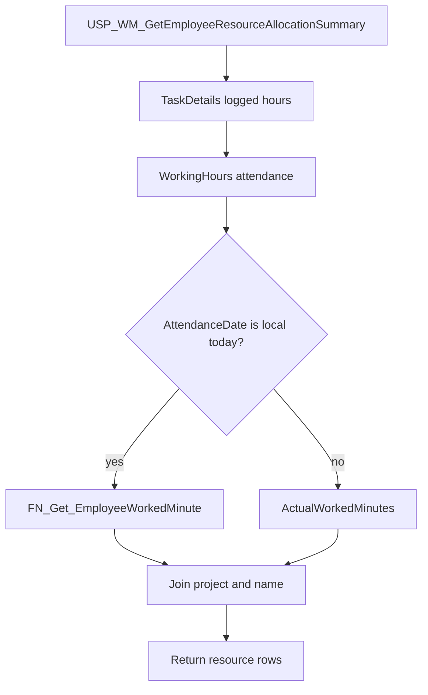

# USP_WM_GetEmployeeResourceAllocationSummary

## What it does

For one employer and date range, returns one row per employee/project that has active task activity in range: resource display name, attendance-based **workingHours**, task-activity **timeLogged**, and **ProjectName**. Used as the intended data source for Task Management → Resource Summary (PBI 123227 / `TDataCatalog`). Script is present under the QA TimePort `StoredProcedures` tree; it is not inventoried in Liquibase `TDG HRMS DB` `HRM-TIMEPORT/STOREPROCEDURE/`.

## Parameters

| Name | Direction | What it is for |
|---|---|---|
| `@EmployerId` | in | Employer scope for employees and daily register |
| `@StartDate` | in | Inclusive start of activity and attendance window |
| `@EndDate` | in | Inclusive end of activity and attendance window |

## Call sequence

## Callers

No other procedure or function in the QA TimePort `StoredProcedures` tree executes this object. Application: intended Task Management Resource Summary SPA/API (not present in SourceCode checkout). Catalog mentions only.

| Object | Kind | Page |
|---|---|---|
| (none in SQL tree) | — | — |

## Nested

| Object | Kind | When | Page |
|---|---|---|---|
| `Fn_GetEmployeeName` | function | final SELECT `resourceName` | [Fn_GetEmployeeName](/docs/database/hrms/Fn_GetEmployeeName) |
| `FN_GetLocalTime` | function | WorkingHours CTE when attendance date is local today | [FN_GetLocalTime](/docs/database/hrms/FN_GetLocalTime) |
| `FN_Get_EmployeeWorkedMinute` | function | same today branch for in-progress minutes | [FN_Get_EmployeeWorkedMinute](/docs/database/hrms/FN_Get_EmployeeWorkedMinute) |

## Steps

1. `SET NOCOUNT ON`.
2. CTE `TaskDetails` — join `TWM_Task` → `TWM_TaskAssignments` → active `TWM_TaskActivityDetail` → `TEmployee`; filter `t.IsActive = 1`, employer, `ActivityDate` between `@StartDate` and `@EndDate`; sum `Duration` as `TotalLoggedHours` per `EmployeeId`, `ProjectId`.
3. CTE `WorkingHours` — from `TDailyRegisterNew` for those employees in the same date range and employer; for today’s local date use `FN_Get_EmployeeWorkedMinute` (clamped at 0) else `ActualWorkedMinutes`; sum to hours (`/ 60.0`).
4. Final SELECT joins `TaskDetails` to `TProject`, `WorkingHours`, optional `TTSProjectConfiguration` / `TTSUserProjectMapping`; keep non-deleted projects with `pc.IsActive = 'Y'`; return `id`, `resourceName`, `workingHours`, `timeLogged`, `ProjectName`.

## Tables

| Table | Read or write |
|---|---|
| `TWM_Task` | read |
| `TWM_TaskAssignments` | read |
| `TWM_TaskActivityDetail` | read |
| `TEmployee` | read |
| `TDailyRegisterNew` | read |
| `TProject` | read |
| `TTSProjectConfiguration` | read |
| `TTSUserProjectMapping` | read |

## Unresolved calls

None.

## Flow

