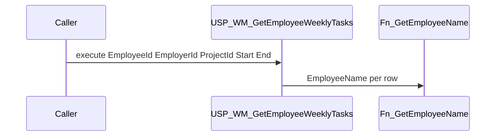
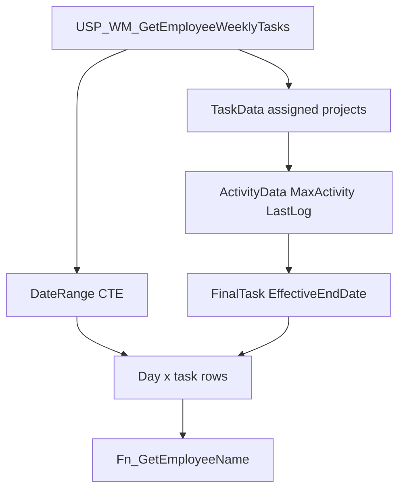

# USP_WM_GetEmployeeWeeklyTasks

## What it does

Returns one row per calendar day × assigned task for a single employee inside a date window. Builds a recursive `DateRange` CTE, finds active `TWM_Task` / `TWM_TaskAssignments` rows for `@EmployeeId` whose project id is in the `@ProjectId` CSV, computes an effective start/end (including overdue unfinished tasks extended to today), aggregates work-log duration and completion per activity day, and resolves status / priority / work-item-type labels from `TWM_ReferenceMaster`. Used by Nest `GET /my-work` for the My Work board.

## Parameters

| Name | Direction | What it is for |
|---|---|---|
| `@EmployeeId` | in | Assignee whose tasks are plotted |
| `@EmployerId` | in | Employer filter on `TWM_Task` and reference rows |
| `@ProjectId` | in | Comma-separated project ids (`STRING_SPLIT`). Empty/null yields **no** rows (null-all branch is commented out) |
| `@StartDate` | in | Inclusive first day of the board window |
| `@EndDate` | in | Inclusive last day of the board window |

## Call sequence

## Callers

| Object | Kind | Page |
|---|---|---|
| Nest `GET /my-work` | app | [My Work](/docs/guides/task-management/my-work) |

No other TIMEPORT procedure `EXEC`s this object (string scan of live modules not exhaustive).

## Nested

| Object | Kind | When | Page |
|---|---|---|---|
| `Fn_GetEmployeeName` | function | final SELECT `EmployeeName` | [Fn_GetEmployeeName](/docs/database/hrms/Fn_GetEmployeeName) |

## Steps

From the live `HRM_CL_TIMEPORT` definition:

1. `SET NOCOUNT ON`.
2. CTE `DateRange` — recursive days from `@StartDate` through `@EndDate` (`MAXRECURSION 1000`).
3. CTE `TaskData` — active tasks assigned to `@EmployeeId` for `@EmployerId` with `ProjectId` in `STRING_SPLIT(@ProjectId)`; compute `EffectiveStartDate` as min of planned/actual start.
4. CTEs `ActivityData` / `MaxActivity` / `LastLog` — sum duration and max completion per activity day; identify latest log day for CompletedOn (100% completion rule).
5. CTE `FinalTask` — join task + activity aggregates; compute `EffectiveEndDate` (completed date, else max of plan/actual/activity/today when overdue).
6. Final SELECT cross-joins `DateRange` to `FinalTask` for days in the effective window; outer-apply status/priority/work-item-type names from `TWM_ReferenceMaster`; resolve `EmployeeName` via `Fn_GetEmployeeName`; join `TProject` for `ProjectName`.

## Tables

| Table | Read or write |
|---|---|
| `TWM_Task` | read |
| `TWM_TaskAssignments` | read |
| `TWM_TaskActivityDetail` | read |
| `TWM_ReferenceMaster` | read |
| `TProject` | read |

## Unresolved calls

None.

## Flow

