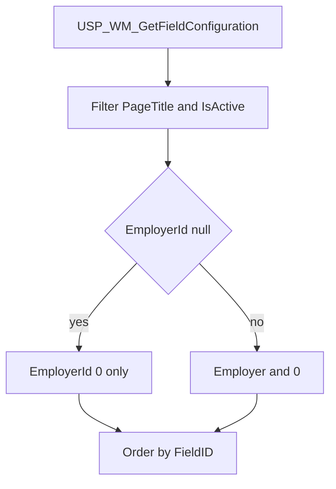

# USP_WM_GetFieldConfiguration

## What it does

Returns active field-configuration rows from `TWM_FieldConfiguration` for a given `@PageTitle`. When `@EmployerId` is null, only employer `0` (default) rows are returned; otherwise rows for that employer and employer `0` are returned. Ordered by `FieldID`. Catalog maps this to Configuration `GET /task-feature-config/field-config`.

## Parameters

| Name | Direction | What it is for |
|---|---|---|
| `@EmployerId` | in | Optional employer; null means defaults only |
| `@PageTitle` | in | Page title key for the field set |

## Call sequence

Calls no other procedures or functions.

## Callers

Application caller: Work Management API `GET /task-feature-config/field-config` for Task Management → Configuration.

## Nested

Calls no other procedures or functions.

## Steps

1. Set `READ UNCOMMITTED`.
2. Select active rows from `TWM_FieldConfiguration` matching `@PageTitle`.
3. Restrict to `EmployerId = 0` when `@EmployerId` is null; otherwise `EmployerId IN (@EmployerId, 0)`.
4. Order by `FieldID`.

## Tables

| Table | Read or write |
|---|---|
| `dbo.TWM_FieldConfiguration` | read |

## Flow

