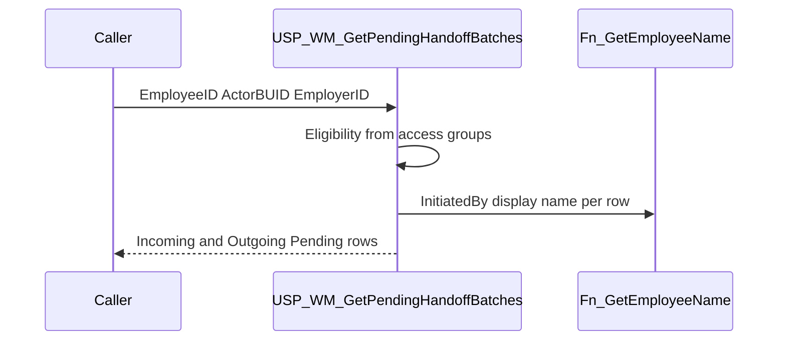
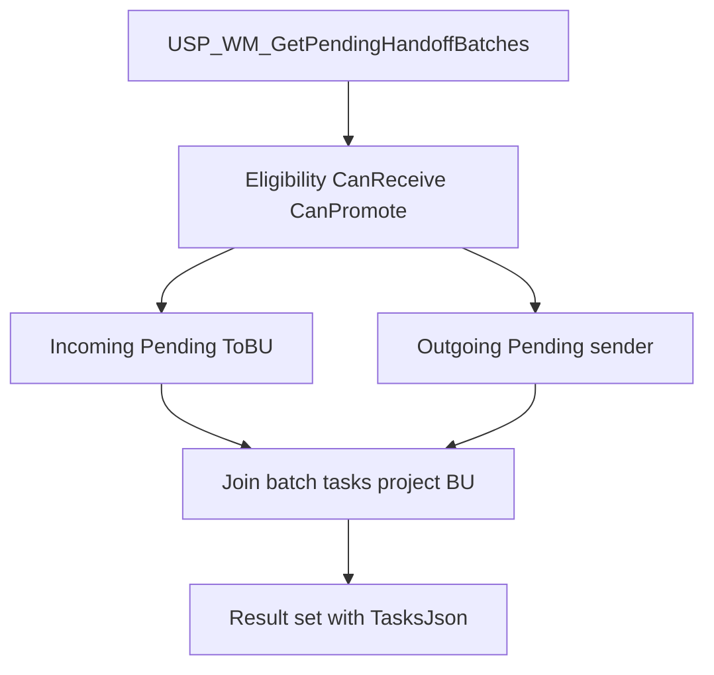

# USP_WM_GetPendingHandoffBatches

## What it does

Loads Pending Task Batch Handoff rows for the **Stage Approvals** surface. Returns **Incoming** batches (caller’s org BU is `ToBUID` and they hold `ReceiveStagePromotions`) and **Outgoing** batches (caller is initiator, or sending-BU manager with `AllowStagePromotion`). Each row includes project/BU names, initiator display name, task count, and a `TasksJson` payload. Header cites RAD section `GET /stage-handoff/pending`.

## Parameters

| Name | Direction | What it is for |
|---|---|---|
| `@EmployeeID` | in | Logged-in employee (JWT/service-derived) |
| `@ActorBUID` | in | Caller’s asserted org BU |
| `@EmployerID` | in | Tenant employer |

## Call sequence

## Callers

Work Management API `GET /stage-handoff/pending` (controller not in SourceCode checkout). Stage Approvals SPA.

## Nested

| Object | Kind | When | Page |
|---|---|---|---|
| `Fn_GetEmployeeName` | function | Initiator name on each card | [Fn_GetEmployeeName](/docs/database/hrms/Fn_GetEmployeeName) |

## Steps

1. Definition lives in live DEV `HRM_CL_TIMEPORT` (no Liquibase script in this checkout).
2. Build `Eligibility` CTE from active System `TWM_TAccessGroupMembers` / `TWM_TAccessGroupPermissions` for `@EmployeeID` / `@EmployerID` (`CanReceive`, `CanPromote`).
3. Union Incoming (`Status = Pending`, `ToBUID = @ActorBUID`, `CanReceive`) with Outgoing (`Pending`, initiator or FromBU + `CanPromote`).
4. Join batch header, BU names, project name; compute task count and `TasksJson` from `TWM_HandoffBatchTask` + `TWM_Task`.
5. Order by `InitiatedAt` descending.

## Tables

| Table | Read or write |
|---|---|
| `TWM_TAccessGroupMembers` | read |
| `TWM_TAccessGroupPermissions` | read |
| `TWM_HandoffBatch` | read |
| `TWM_HandoffBatchTask` | read |
| `TWM_Task` | read |
| `TOrgHierarchyDetails` | read |
| `TProject` | read |

## Flow

