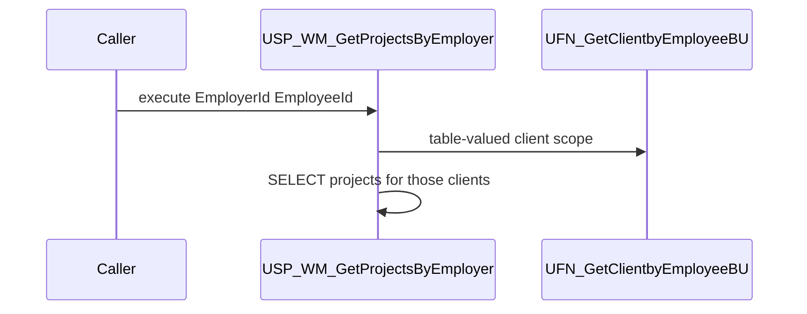
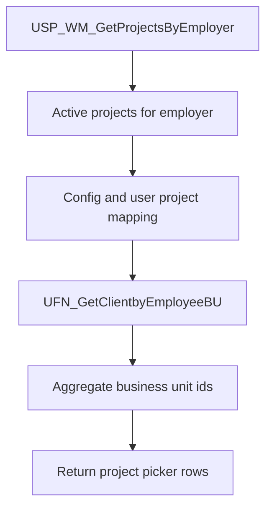

# USP_WM_GetProjectsByEmployer

## What it does

Returns the project picker list for an employer filtered to clients the calling employee may see. Joins active Timeport project configuration and user–project mapping, then keeps only clients from `UFN_GetClientbyEmployeeBU(@EmployeeId)`. Each row is a project with client id, aggregated business-unit ids, and optional parent project id.

## Parameters

| Name | Direction | What it is for |
|---|---|---|
| `@EmployerId` | in | Employer whose projects are listed |
| `@EmployeeId` | in | Employee whose client/BU scope drives the TVF filter |

## Call sequence

## Callers

| Object | Kind | Page |
|---|---|---|
| Nest `GET project/employer` | app | [Dashboard](/docs/guides/task-management/dashboard) |

No other TIMEPORT procedure `EXEC`s this object.

## Nested

| Object | Kind | When | Page |
|---|---|---|---|
| `UFN_GetClientbyEmployeeBU` | function | always — `INNER JOIN` on client id | [UFN_GetClientbyEmployeeBU](/docs/database/hrms/UFN_GetClientbyEmployeeBU) |

## Steps

From the live `HRM_CL_TIMEPORT` definition of `USP_WM_GetProjectsByEmployer`:

1. Select from `TProject` for `@EmployerId` where not deleted.
2. Require `TClientProjectMapping`, active `TTSProjectConfiguration`, and active `TTSUserProjectMapping`.
3. Restrict to clients returned by `UFN_GetClientbyEmployeeBU(@EmployeeId)`.
4. Left-join `TClientBusinessUnitMapping` and `STRING_AGG` business-unit ids per project/client.
5. Group and order by project name.

## Tables

| Table | Read or write |
|---|---|
| `TProject` | read |
| `TClientProjectMapping` | read |
| `TTSProjectConfiguration` | read |
| `TTSUserProjectMapping` | read |
| `TClientBusinessUnitMapping` | read |

## Flow

