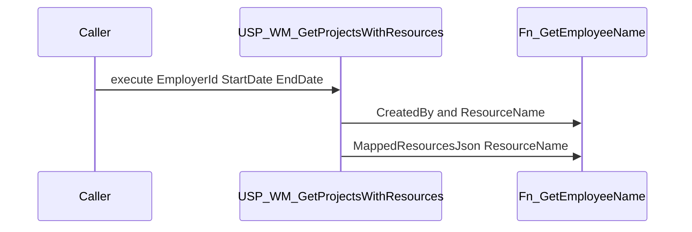
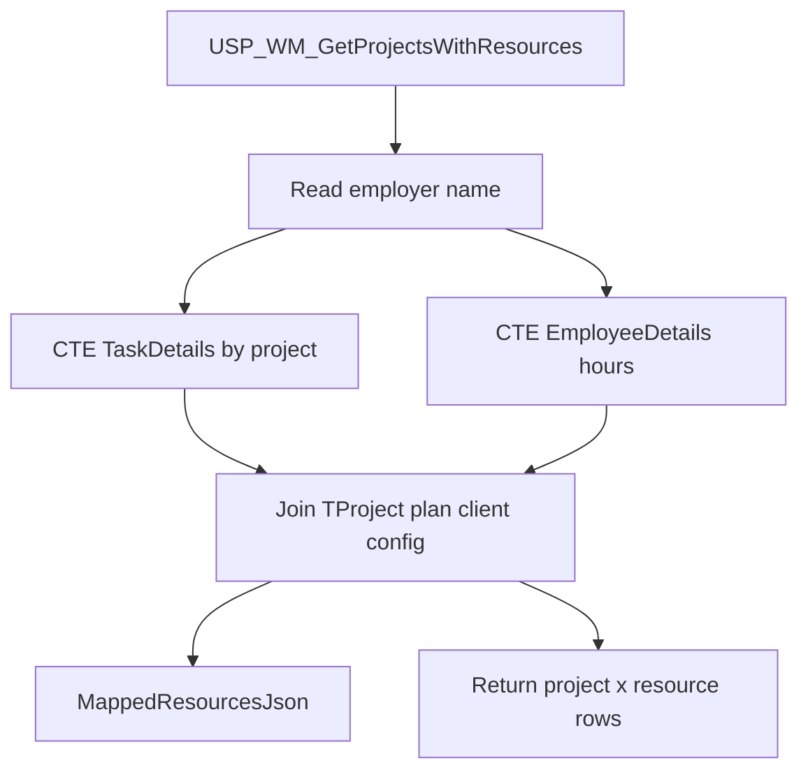

# USP_WM_GetProjectsWithResources

## What it does

Builds the Task Management **Dashboard** grid: one result set of project × assigned-resource rows for an employer, optionally bounded by activity date. For each active project that has task activity in range it returns client/project names, planned vs activity timeline, slippage days past the project plan end, total logged hours per assigned employee, created-by name, and a `MappedResourcesJson` array of Timeport resource-mapping employees (with logged hours, defaulting to 0 when mapped but idle). Sibling procedure comments name this object “the Dashboard.”

## Parameters

| Name | Direction | What it is for |
|---|---|---|
| `@EmployerId` | in | Employer whose projects and employees are in scope |
| `@StartDate` | in | Optional lower bound on `TWM_TaskActivityDetail.ActivityDate` |
| `@EndDate` | in | Optional upper bound on activity date |

## Call sequence

## Callers

| Object | Kind | Page |
|---|---|---|
| Nest `GET project/with-resources` | app | [Dashboard](/docs/guides/task-management/dashboard) |
| Reports / Resource Summary / mobile (per procedure comment) | app | No page yet |

No other TIMEPORT procedure `EXEC`s this object (string mentions in comments only).

## Nested

| Object | Kind | When | Page |
|---|---|---|---|
| `Fn_GetEmployeeName` | function | created-by, assignment resource, mapped-resource names | [Fn_GetEmployeeName](/docs/database/hrms/Fn_GetEmployeeName) |

## Steps

From the live `HRM_CL_TIMEPORT` definition of `USP_WM_GetProjectsWithResources`:

1. Resolve `@EmployerName` from `TEmployerDetails` for `@EmployerId` (name is not returned).
2. CTE `TaskDetails` — per `ProjectID`, activity date span and max activity date from active tasks/assignments/activity in the optional date window.
3. CTE `EmployeeDetails` — per project and assignee, `SUM` of active activity `Duration` as `TotalLoggedHours`.
4. Select from `TProject` joined to both CTEs, `TEmployee` (employer filter), `TProjectConfDetails`, active `TTSProjectConfiguration`, client mapping, and `TClient`.
5. Compute `SlippageDays` when activity end is after plan end; resolve display names via `Fn_GetEmployeeName`.
6. Correlate `MappedResourcesJson` from active `TTSUserProjectMapping` under the project’s config, left-joining logged hours so mapped-but-idle resources show `0`.

## Tables

| Table | Read or write |
|---|---|
| `TEmployerDetails` | read |
| `TWM_Task` | read |
| `TWM_TaskAssignments` | read |
| `TWM_TaskActivityDetail` | read |
| `TProject` | read |
| `TProjectConfDetails` | read |
| `TTSProjectConfiguration` | read |
| `TTSUserProjectMapping` | read |
| `TClientProjectMapping` | read |
| `TClient` | read |
| `TEmployee` | read |

## Flow

