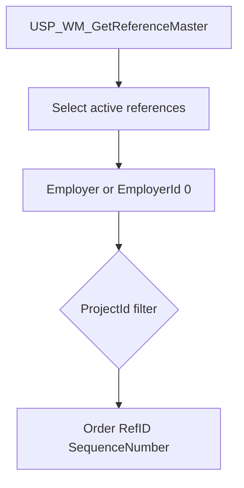

# USP_WM_GetReferenceMaster

## What it does

Lists active `TWM_ReferenceMaster` rows for Configuration → **REFERENCE DATA**. Includes the caller's `@EmployerId` rows and global defaults (`EmployerId = 0`). Optional `@ProjectId` filter. Marks defaults with `IsDefault = 1` when `EmployerId = 0`. Ordered by `RefID`, `SequenceNumber`.

## Parameters

| Name | Direction | What it is for |
|---|---|---|
| `@EmployerId` | in | Employer whose references are listed |
| `@ProjectId` | in | Optional project filter |

## Call sequence

Calls no other procedures or functions.

## Callers

Application caller: Work Management API `GET /reference` for Task Management → Configuration → REFERENCE DATA.

## Nested

Calls no other procedures or functions.

## Steps

1. Select active reference columns from `TWM_ReferenceMaster`.
2. Keep rows where `EmployerId = @EmployerId` or `EmployerId = 0`.
3. Apply optional `@ProjectId` equality filter.
4. Compute `IsDefault` and order by `RefID`, `SequenceNumber`.

## Tables

| Table | Read or write |
|---|---|
| `dbo.TWM_ReferenceMaster` | read |

## Flow

