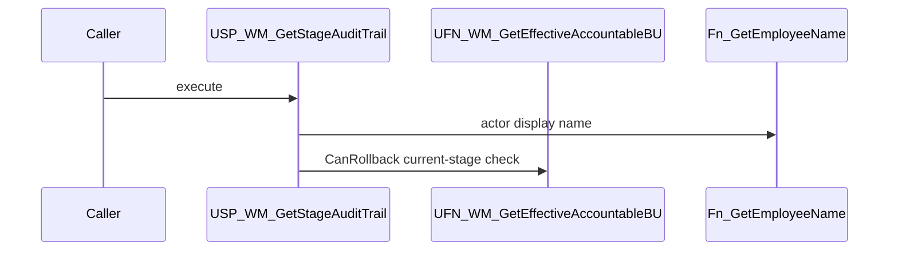
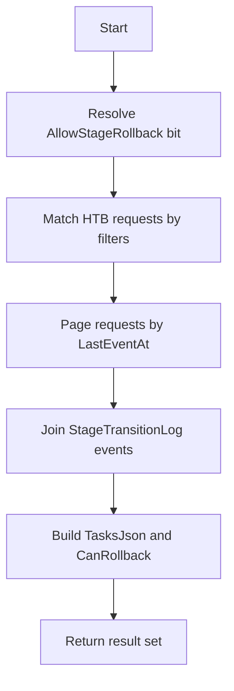

# USP_WM_GetStageAuditTrail

## What it does

Request-centric Stage Audit query for Task Batch Handoff (FR-19 / GET `stage-handoff/audit`). Filters and pagination operate on **handoff requests** (`TWM_HandoffBatch`), then return every `TWM_StageTransitionLog` event for the current page of requests so the UI can render one card per request with a full timeline. Also computes per-request `CanRollback` for the service-asserted actor (`AllowStageRollback` + actor BU = ToBU + Accepted + no pending overlap + current-stage check via `UFN_WM_GetEffectiveAccountableBU`).

## Parameters

| Name | Direction | What it is for |
|---|---|---|
| `@EmployerID` | in | Tenant scope (required) |
| `@ProjectID` | in | Optional single-project filter |
| `@BUID` | in | Legacy From **or** To BU filter (retained) |
| `@EventType` | in | Request-status filter; `Initiated` maps to `Pending` |
| `@FromDate` / `@ToDate` | in | Match if any event on the request falls in range (`ToDate` inclusive day) |
| `@PageNumber` / `@PageSize` | in | Request paging (default 1 / 50, max 500) |
| `@ActorEmployeeID` / `@ActorBUID` | in | JWT-asserted caller for `CanRollback` |
| `@ProjectIDs` | in | Optional CSV multi-project filter |
| `@FromBUID` / `@ToBUID` | in | Independent From/To BU filters (ANDed) |

## Call sequence

## Callers

No other procedure in TIMEPORT inventories this object (scripts not in Liquibase). Application caller: Nest `GET stage-handoff/audit` → Stage Audit UI ([Stage Audit](/docs/guides/task-management/stage-audit)).

## Nested

| Object | Page |
|---|---|
| `UFN_WM_GetEffectiveAccountableBU` | [UFN_WM_GetEffectiveAccountableBU](/docs/database/hrm-timeport/UFN_WM_GetEffectiveAccountableBU) |
| `Fn_GetEmployeeName` | [Fn_GetEmployeeName](/docs/database/hrms/Fn_GetEmployeeName) |

## Steps

1. Resolve `@HasRollbackBit` from System access-group `AllowStageRollback` for `@ActorEmployeeID`.
2. Map `@EventType = 'Initiated'` to Status `Pending`; build `MatchingRequests` on `TWM_HandoffBatch` with project / BU / date filters.
3. Rank by last event time; page by request; set `TotalRows` = request count.
4. Select all `TWM_StageTransitionLog` rows for paged HTBIDs with project/BU names, `TasksJson` (task number/title/parent), and `CanRollback`.
5. Order requests newest-first; events within a request chronological.

## Tables

| Table | Access | What it is for |
|---|---|---|
| `TWM_HandoffBatch` | read | Request identity, status, From/To BU |
| `TWM_StageTransitionLog` | read | Per-event audit rows |
| `TWM_HandoffBatchTask` | read | Tasks in batch + `TasksJson` |
| `TWM_Task` | read | TaskNumber, Title, ParentTaskGuid, CurrentStageBUID |
| `TWM_TAccessGroupMembers` / `TWM_TAccessGroupPermissions` | read | Rollback bit |
| `TProject`, `TOrgHierarchyDetails` | read | Display names (synonyms / cross-DB) |

## Unresolved calls

None beyond nested objects above.

## Flow

