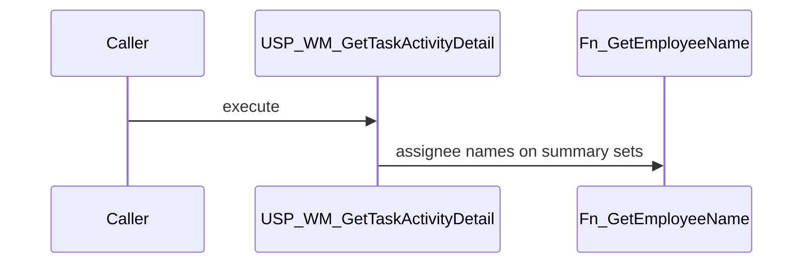
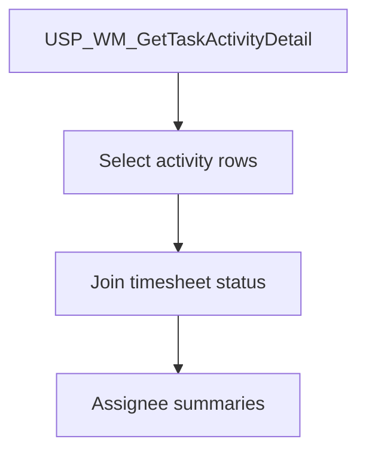

# USP_WM_GetTaskActivityDetail

## What it does

Returns active work-log rows for one task assignment (with timesheet status when mapped), plus assignee summary result sets used by the Work Log drawer. Used by Nest GET /tasks/activity-detail.

## Parameters

| Name | Direction | What it is for |
|---|---|---|
| @TaskGuid | in | Task |
| @TaskAssignmentID | in | Assignment whose logs are listed |

## Call sequence

## Callers

No other procedure or function executes this object. Application caller: Nest tasks activity-detail GET.

## Nested

| Object | Kind | When | Page |
|---|---|---|---|
| Fn_GetEmployeeName | function | assignee summary sets | [Fn_GetEmployeeName](/docs/database/hrms/Fn_GetEmployeeName) |

## Steps

1. Resolve ProjectID from TWM_Task.
2. Select active TWM_TaskActivityDetail for the assignment; left join timesheet map and TTSEmpTimeSheet status.
3. Additional result sets summarize latest completion per assignment and assignee names.

## Tables

| Table | Read or write |
|---|---|
| TWM_Task | read |
| TWM_TaskActivityDetail | read |
| TWM_TaskActivityTimesheetMap | read |
| TTSEmpTimeSheet | read |
| TWM_TaskAssignments | read |

## Flow

