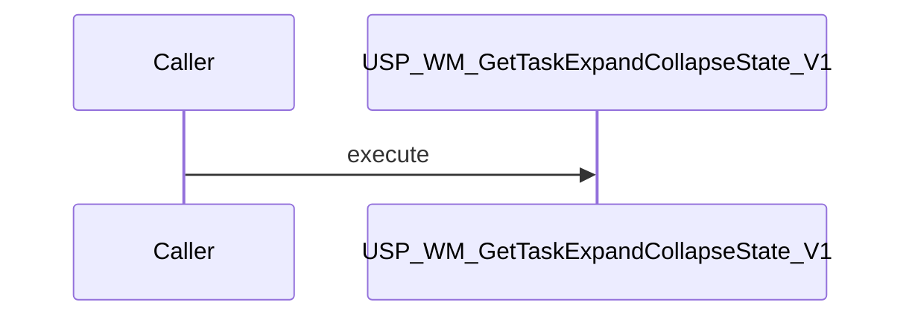
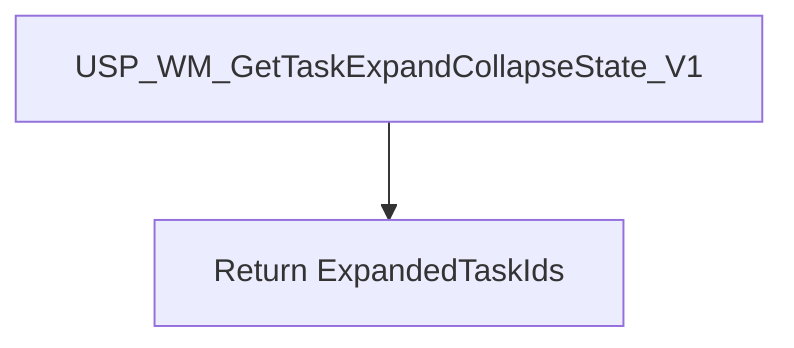

# USP_WM_GetTaskExpandCollapseState_V1

## What it does

Reads the single `ExpandedTaskIds` blob for employer/project/employee/BU/page type.

## Parameters

| Name | Direction | What it is for |
|---|---|---|
| `@EmployerId` | in | Employer id (`INT`) |
| `@ProjectId` | in | Project id (`INT`) |
| `@EmployeeId` | in | Employee id (`INT`) |
| `@BusinessUnitId` | in | Business unit id (`INT`) |
| `@PageType` | in | Page key (`VARCHAR(50)`) |

## Call sequence

## Callers

Catalog `GET /tasks/expand-collapse-state` for Tasks.

## Nested

This object does not execute another procedure.

## Steps

In live DEV `HRM_CL_TIMEPORT.dbo.USP_WM_GetTaskExpandCollapseState_V1`:

1. Selects `TOP 1 ExpandedTaskIds` from `TWM_TaskExpandCollapseState` for the key tuple.

## Tables

| Table | Read or write |
|---|---|
| `TWM_TaskExpandCollapseState` | read |

## Unresolved calls

None.

## Flow

