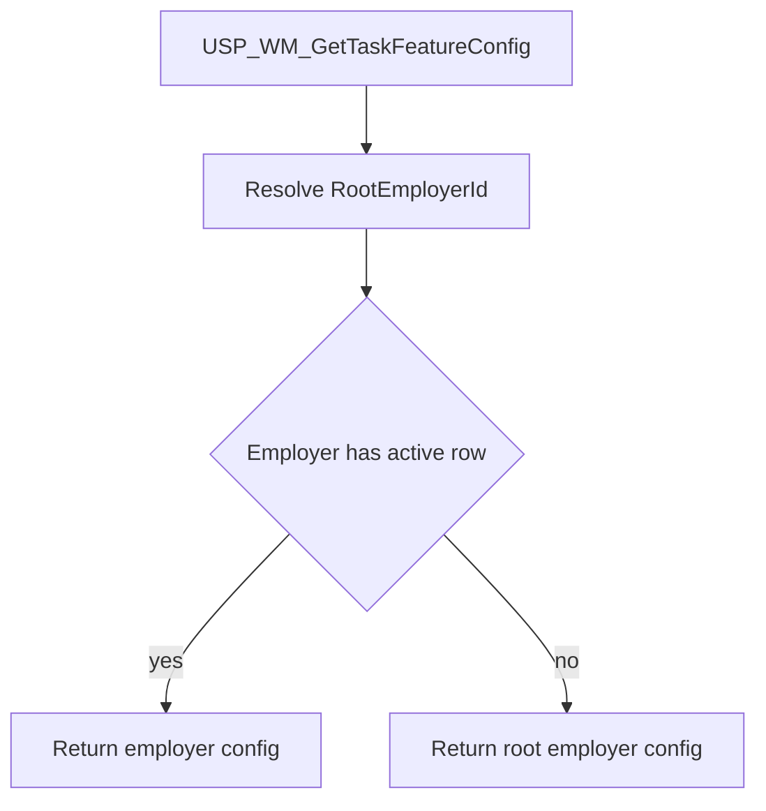

# USP_WM_GetTaskFeatureConfig

## What it does

Returns the active Task Management **TASK SETUP** row from `TWM_TaskFeatureConfig` for an employer. Prefers a row owned by `@EmployerId`; if that employer has never saved its own config, falls back to the root employer's row (`TEmployerDetails.RootEmployerId`). Optional `@ProjectId` narrows the match.

## Parameters

| Name | Direction | What it is for |
|---|---|---|
| `@EmployerId` | in | Employer whose config is requested |
| `@ProjectId` | in | Optional project scope filter |

## Call sequence

Calls no other procedures or functions.

## Callers

Application caller: Work Management API `GET /task-feature-config` (Task Management → Configuration → TASK SETUP). No other procedure or function in TIMEPORT was listed as a SQL caller in this analysis pass.

## Nested

Calls no other procedures or functions.

## Steps

1. Resolve `@RootEmployerId` from `TEmployerDetails` for `@EmployerId` (`ISNULL(RootEmployerId, @EmployerId)`).
2. If an active `TWM_TaskFeatureConfig` row exists for `@EmployerId` (and optional `@ProjectId`), select that employer's columns (feature flags, handoff, `NotificationFlags`, audit).
3. Otherwise select the same columns for `@RootEmployerId` with the same project filter.

## Tables

| Table | Read or write |
|---|---|
| `dbo.TEmployerDetails` | read |
| `dbo.TWM_TaskFeatureConfig` | read |

## Flow

